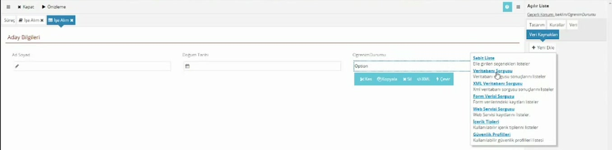
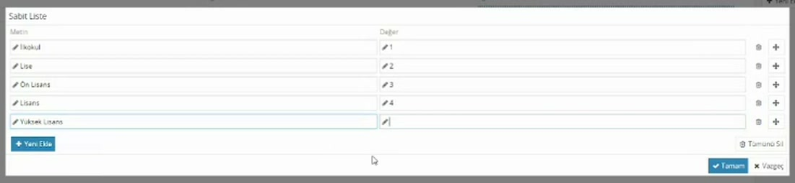
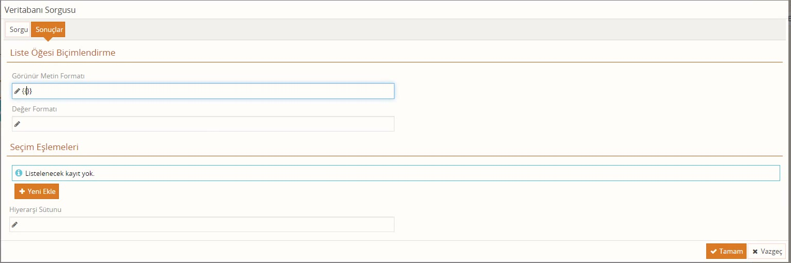

# Açılır liste

> **Taslak.** Biçim ve içerik onayı bekliyor.

Kullanıcının hazır seçeneklerden birini seçmesini istediğiniz alanlarda (öğrenim durumu, şehir) açılır liste kullanılır. Bu sayfa listenin veri modelini, seçeneklerini tanımlamayı ve boş başlamasını sağlamayı anlatır.

## Değer ve yazı ayrı tutulur

Her seçeneğin iki parçası vardır:

- **Metin:** Kullanıcının gördüğü yazı (Lisans).
- **Değer:** Arkada saklanan kısa kod (4).

Kurallarda ve scriptlerde karşılaştırmayı değer üzerinden yapın. "Öğrenim durumu `Lisans` ise" yerine "öğrenim durumu `4` ise" yazarsanız, yazının büyük-küçük harfi ya da Türkçe karakteri yüzünden kural bozulmaz; yazıyı sonradan değiştirseniz de kural çalışmayı sürdürür.

## 1. Veri modelini hazırlayın

Alanı **Bölüm** tipinde tanımlayın ve altına **Metin** tipinde iki eleman ekleyin: önce `Id`, sonra `Name`. Ayrıntısı: [Veri modeli → Seçim listesi için eleman](/veri-modeli#secim-listesi-icin-eleman).

Alan düz **Metin** tipindeyse forma metin kutusu olarak gelir, liste olarak gelmez.

## 2. Alanı forma ekleyin

Form tasarımcısında **Yeni Ekle** ile alanı ekleyin. Bu yapıdaki alan **Açılır Liste** olarak gelir; **Yeni Ekle** menüsünde simgesi de metin alanlarından farklıdır.

Seçili bileşenin **Veri** sekmesinde **Değer XPath'i** (`Id`) ve **Başlık XPath'i** (`Name`) kendiliğinden dolmuştur. Kullanıcı bir seçenek seçtiğinde seçeneğin değeri `Id`'ye, yazısı `Name`'e yazılır.

## 3. Seçenekleri tanımlayın: veri kaynağı

Yeni eklenen liste boştur. Seçeneklerin nereden geleceğini **Veri Kaynakları** sekmesinden belirlersiniz.

1. Açılır listeye tıklayın, sağ panelde **Veri Kaynakları** sekmesine geçin.
2. **Yeni Ekle**'ye basın ve kaynak türünü seçin.

| Kaynak | Seçenekler nereden gelir |
|---|---|
| Sabit Liste | Elle yazdığınız seçenekler. |
| Veritabanı Sorgusu | Bir veri tabanı sorgusunun sonuçları. |
| XML Veritabanı Sorgusu | XML veri tabanı sorgusunun sonuçları. |
| Form Verisi Sorgusu | Formdaki verinin içindeki kayıtlar. |
| Web Servisi Sorgusu | Bir web servisinin döndürdüğü kayıtlar. |
| İçerik Tipleri | Kullanılabilir içerik tipleri. |
| Güvenlik Profilleri | Kullanılabilir güvenlik profilleri. |

Seçenekler az ve sabitse **Sabit Liste** yeterlidir. Seçenekler bir tabloda tutuluyor ve zamanla değişiyorsa **Veritabanı Sorgusu** kullanılır.

### Sabit Liste

Kaynak eklendikten sonra yanında iki simge görünür: kalem düzenler, çöp kutusu siler.

1. Kaleme tıklayın.
2. **Yeni Ekle** ile satır ekleyin; her satıra **Metin** ve **Değer** yazın.
3. **Tamam** deyin.

Satırın sağındaki çöp kutusu o satırı siler, yanındaki taşıma simgesi satırın sırasını değiştirir. Seçenekler kullanıcıya buradaki sırayla gösterilir.

> **Değer olarak `0` kullanmayın.** Zorunlu alan denetimi `0` değerini boş sayar; değeri `0` olan seçeneği seçen kullanıcı "Bu alan zorunludur." uyarısı alır. Numaralandırmaya 1'den başlayın.

### Veritabanı Sorgusu

Seçenekleri bir tablodan getirmek için kaynak türü olarak **Veritabanı Sorgusu**'nu seçin. Tablonun şeması sürece alınmış olmalıdır: [Veritabanları](/veritabanlari).

**Sorgu** sekmesinde:

1. **Hedef Şema** ve **Hedef Tablo**'yu seçin.
2. **Alan Ekle** ile seçeneğin değeri ve yazısı olacak sütunları ekleyin (örnek: `Id` ve `Name`). İlişkili tablodaki bir sütunu noktayla alabilirsiniz: `Position.Name`.
3. İsterseniz **Sıralama** ekleyin.

**Sonuçlar** sekmesinde hangi sütunun yazı, hangisinin değer olacağını belirtin:

| Alan | Ne yazılır | Örnek |
|---|---|---|
| Görünür Metin Formatı | Kullanıcının göreceği yazı | <code v-pre>{{Name}}</code> |
| Değer Formatı | Arkada saklanacak değer | <code v-pre>{{Id}}</code> |

Sütun adları çift süslü parantez içinde yazılır. Parantezlerin dışına yazdığınız her şey olduğu gibi gösterilir; böylece yazıyı birkaç sütundan oluşturabilirsiniz: <code v-pre>{{Name}} ({{Code}})</code> yazarsanız seçenekler "Otel (K01)" biçiminde görünür.

İki alan da zorunludur. Liste boş geliyorsa önce bu iki alanı denetleyin.

### Birden çok kaynak

Bir listeye birden çok veri kaynağı ekleyebilirsiniz (örnek: bir **Sabit Liste** ile bir **Veritabanı Sorgusu**). Seçenekler kaynakların sırasıyla tek listede birleştirilir. Aynı değere sahip iki seçenek gelirse yalnızca biri gösterilir.

## Listenin boş başlaması

Açılır liste, hiçbir şey seçilmemişse **ilk seçeneği kendiliğinden seçer** ve değerini veriye yazar. Kullanıcı listeye hiç dokunmasa da alan dolu sayılır; [zorunlu alan](/zorunlu-alanlar) denetimi bu yüzden hiçbir zaman uyarı vermez ve yanlışlıkla ilk seçenekle kayıt oluşur.

Bunu önlemenin iki yolu var:

- **Otomatik Değer Seç'i kapatın.** Açılır listeyi seçin, **Tasarım** sekmesinde **Otomatik Değer Seç** işaretini kaldırın. Liste seçimsiz açılır, değer boş kalır.
- **Boş bir seçenek ekleyin.** Sabit Liste'ye **Metin**'i "Seçiniz", **Değer**'i boş olan bir satır ekleyin ve taşıma simgesiyle en üste alın. Değeri boş olan satır varsa liste onunla açılır.

İki durumda da kullanıcı gerçek bir seçenek seçene kadar zorunluluk uyarısı çıkar.

## Birbirine bağlı listeler

Bir listenin seçenekleri başka bir alanın değerine göre süzülebilir: müşteri seçilince proje listesinde yalnızca o müşterinin projeleri görünsün.

Bunun için ikinci listenin (proje) veri kaynağı **Veritabanı Sorgusu** olmalı ve projelerin tutulduğu tabloda projenin hangi müşteriye ait olduğu yazmalıdır.

1. Proje listesini seçin, **Veri Kaynakları** sekmesinde sorguyu düzenleyin.
2. **Kriter** bölümünde **Yeni Kriter Ekle**'ye basın.
3. **Alan**'a tablodaki müşteri sütununu, **Karşılaştırma**'ya **Eşit**'i seçin.
4. **Değer**'e formdaki müşteri alanını çift süslü parantez içinde yazın: <code v-pre>{{Musteri/Id}}</code>

**Değer**'e düz metin yazarsanız sabit bir değerle, çift süslü parantez içinde yol yazarsanız formdaki alanın o anki değeriyle karşılaştırılır. Yol, listenin bulunduğu yere göre yazılır: liste bir tablo satırındaysa aynı satırdaki müşteri <code v-pre>{{Musteri/Id}}</code> olur.

Kullanıcı müşteriyi değiştirdiğinde proje listesi kendiliğinden yeniden yüklenir.

**Değer**'e `NULL` yazıp **Karşılaştırma**'yı **Eşit** seçerseniz o sütunu boş olan kayıtlar, **Farklı** seçerseniz dolu olanlar gelir.

Seçenekleri değiştirmek yerine formun bir bölümünü koşula göre göstermek için **Koşullu İçerik** bileşeni kullanılır: [Form tasarımı → Koşullu İçerik](/form-tasarimi#kosullu-icerik).

## Radyo düğme ve diğer liste bileşenleri

Aynı veri yapısı ve aynı **Veri Kaynakları** sekmesi şu bileşenlerde de kullanılır. Açılır listeyi seçip **Çevir** düğmesiyle bunlara dönüştürebilirsiniz.

- **Radyo Buton:** Seçenekleri yan yana ya da alt alta gösterir (**Tasarım** → **Yerleşim**: **Yatay** / **Dikey**). Az seçenekli alanlar için uygundur. **Otomatik Değer Seç** ayarı yoktur.
- **Seçim Listesi:** Yazdıkça arayan liste; uzun listeler için. **Kurallar** sekmesinde **En az Uzunluk** aramanın kaç harften sonra başlayacağını belirler; **Yeni Eklemeye İzin Ver** işaretlenirse kullanıcı listede olmayan bir metin de yazabilir (bu durumda yalnızca yazı saklanır, değer boş kalır).
- **Ağaç Listesi:** Seçenekleri iç içe gösterir.

---

**Kaynak:** CodEase Eğitim 1 – Fatih, 49:30–62:10; CodEase Eğitim 4 – Fatih, 37:40–39:50; CodEase Eğitim 8 – Fatih, 00:00–07:30 ve 45:00–51:00; Veritabanı Eğitimi – Veysel, 58:00–79:00 ve 88:00–96:00. Videoda eksik ya da belirsiz kalan noktalar ürün davranışına göre tamamlandı.
