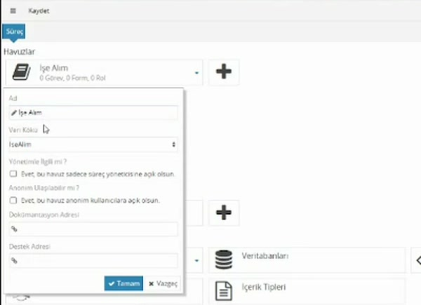
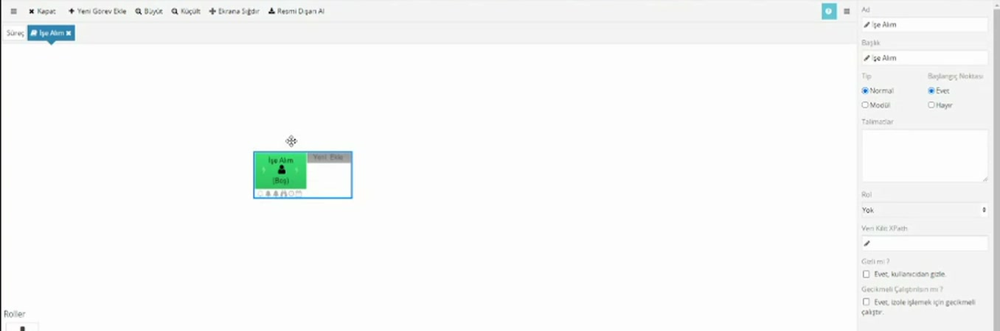
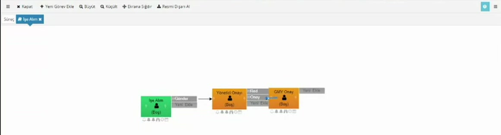
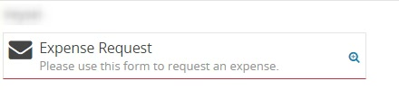
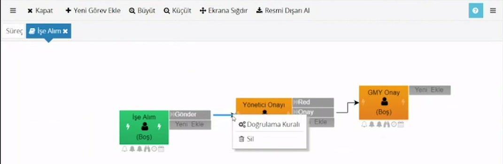
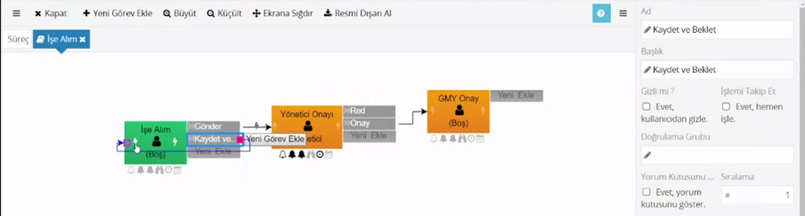

# Akış tasarımı: havuz, görev, aksiyon, rota

> **Taslak.** Biçim ve içerik onayı bekliyor.

Bir süreç çoğunlukla tek adımda bitmez: insan kaynakları aday bilgisini girer, yönetici onaylar, genel müdür yardımcısı son kararı verir. Bu adımların sırasını **havuz** içinde çizersiniz. Bu sayfa havuz oluşturmayı ve akışın dört yapı taşını anlatır:

- **Görev:** Bir kişinin yaptığı adım. Şemada kutu olarak görünür.
- **Aksiyon:** Görevi yapan kişinin basabileceği düğme (Gönder, Onay, Red). Görev kutusunun sağında durur.
- **Rota:** Aksiyondan sonraki göreve giden ok.
- **Havuz:** Görevleri, formları ve rolleri bir arada tutan akış.

Havuzdan önce [veri modelini](/veri-modeli) oluşturun.

## Havuz oluşturma

Süreç ekranında **Havuzlar** başlığının altındaki artıya tıklayın.



| Alan | Ne yazılır |
|---|---|
| Ad | Havuzun adı. |
| Veri Kökü | Bu akışın kullanacağı veri modeli. Listede veri modelinde tanımladığınız kökler çıkar. |
| Yönetimle İlgili mi ? | İşaretlerseniz havuzun başlangıç görevlerini yalnızca süreçte yazma yetkisi olanlar görür. |
| Anonim Ulaşılabilir mi ? | İşaretlerseniz havuz sisteme giriş yapmamış kullanıcılara açılır. |
| Dokümantasyon Adresi, Destek Adresi | İsteğe bağlı bağlantılar. |

Yeni havuz, havuzla aynı adı taşıyan bir **başlangıç görevi** ve bir **form** ile oluşur. Havuza tıkladığınızda üstte akış şeması, altında **Roller**, **Formlar**, **Scriptler** ve **Diğer** başlıkları açılır.



## Görev ekleme

1. Şemanın boş bir yerine sağ tıklayıp **Yeni Görev Ekle**'yi seçin (aynı düğme araç çubuğunda da var). Adı **Görev** olan bir kutu eklenir.
2. Kutuya tıklayın. Sağdaki panelde görevin özellikleri açılır; **Ad** alanından adını değiştirin (örnek: Yönetici Onayı).

**Başlık**, kullanıcının gördüğü addır. **Ad**'ı değiştirdiğinizde ikisi aynıysa **Başlık** da birlikte değişir; farklı bir başlık yazdıysanız dokunulmaz.

Görevin kime atanacağı, bildirimleri, termini ve form ayarları için: [Görev ayarları](/gorev-ayarlari). Görev başlarken ve biterken çalışan scriptler için: [İş Öncesi ve İş Sonrası Script](/is-oncesi-ve-is-sonrasi-script).

## Aksiyon ekleme

Her görev kutusunun sağında soluk bir **Yeni Ekle** kutucuğu durur. Ona çift tıklayıp aksiyonun adını yazın (örnek: Gönder). Görevi yapan kişi bu adı formun üstünde düğme olarak görür.

Bir göreve birden çok aksiyon ekleyebilirsiniz (Onay ve Red gibi).

Aksiyona tıkladığınızda sağ panelde özellikleri açılır: **Ad**, **Başlık**, **Gizli mi ?**, **İşlemi Takip Et**, **Doğrulama Grubu**, **Yorum Kutusunu Göster ?**, **Yorum Gerekli mi ?**, **Sıralama**. **Doğrulama Grubu** zorunlu alanlar için kullanılır: [Zorunlu alanlar](/zorunlu-alanlar).

## Rota çizme

Aksiyon alındığında akışın nereye gideceğini rota belirler.

1. Fareyi aksiyonun sağ kenarına getirin; bir nokta belirir.
2. Noktayı basılı tutup hedef görevin üstüne sürükleyin ve bırakın.



Kısa yol: aksiyon seçiliyken yanında çıkan **Yeni Görev Ekle** düğmesi yeni görevi ve ona giden rotayı tek adımda oluşturur.

Rotayı silmek için okun üstüne sağ tıklayıp **Sil**'i seçin. Okun ucunu başka bir göreve sürükleyerek hedefini değiştirebilirsiniz.

> **Rotası olmayan aksiyon akışı bitirir.** Bir aksiyondan çıkan rota yoksa, o aksiyon alındığında gidilecek görev bulunmaz ve akış tamamlanır. Son onay adımındaki Onay ve Red için istenen budur; ara adımlarda rotayı unutmayın. (Akışta o sırada açık başka görev varsa akış, onlar da bitince tamamlanır.)

## Akışı başlatma

Havuzun başlangıç görevi, sürecin bulunduğu dizinde bir kutucuk olarak görünür. Kullanıcı kutucuğa tıklayınca form açılır ve akış başlar; başlangıç görevi o kullanıcıya atanmış olur.

Kutucukta görevin **Başlık**'ı ve altında **Talimatlar** alanına yazdığınız metin görünür; kullanıcıya formun ne için olduğunu burada söyleyin. Sağdaki büyüteç akışın şemasını gösterir.



Kutucuk şu durumlarda görünmez:

- Havuzda hiç form yoksa.
- Görevin özelliklerinde **Gizli mi ?** işaretliyse.
- Sürecin durumu kullanıcının görmesine izin vermiyorsa ([Süreç durumu](/dizinler-ve-surecler#surec-durumu)).

Bir görevi başlangıç görevi yapan, özelliklerindeki **Başlangıç Noktası** ayarıdır: **Evet** ise görev şemada yeşil, **Hayır** ise turuncu görünür. Bir havuzda birden çok başlangıç görevi olabilir; her biri ayrı kutucuk olur.

## Rotaya koşul koyma: Doğrulama Kuralı

Bir rotanın yalnızca belirli bir koşulda izlenmesini istiyorsanız rotaya kural yazarsınız.

1. Okun üstüne sağ tıklayın ve **Doğrulama Kuralı**'nı seçin.
2. Açılan script alanına doğru ya da yanlış sonuç veren bir ifade yazın.



Kuralı olan rotanın üstünde şimşek simgesi görünür.

**Örnek:** Adaylardan en az birinin öğrenim durumu İlkokul (`Id` değeri 1) ise yönetici onayına gitsin:

```js
$Xml.Count('Adaylar/Aday[OgrenimDurumu/Id = "1"]') > 0
```

- `$Xml.Count(...)` verilen yola uyan elemanları sayar.
- Yol, havuzun **Veri Kökü**'nden başlar; kökün adını (`IseAlim`) yola yazmayın.
- `/` bir alt elemana iner. Köşeli parantez içine koşul yazılır: `Aday[OgrenimDurumu/Id = "1"]`, öğrenim durumu 1 olan adaylar demektir.
- Büyük-küçük harf önemlidir: `$Xml.Count` yazılır, `$xml.count` çalışmaz.

**Kural nasıl sonuçlanır:**

| Durum | Sonuç |
|---|---|
| Kural boş | Rota izlenir. |
| İfade doğru (`true`) | Rota izlenir. |
| İfade yanlış (`false`) ya da hiçbir sonuç vermiyor | Rota izlenmez. |

Bir aksiyondan birden çok rota çıkıyorsa her rotanın kuralı ayrı ayrı değerlendirilir:

- Kuralı doğru çıkan her rota izlenir. Birden çok rota doğruysa hedef görevlerin hepsi aynı anda açılır.
- Hiçbiri doğru değilse aksiyonun rotası yokmuş gibi davranılır ve akış o noktada tamamlanır.

Koşula göre iki ayrı yöne gitmek için aynı aksiyondan iki rota çizin ve kurallarını birbirinin tersi yazın.

Bir görevi koşula göre atlamanın ikinci yolu Otomatik Seçim Scripti'dir: [Koşullu yönlendirme](/kosullu-yonlendirme).

## Aynı göreve dönen rota: Kaydet ve Beklet

Kullanıcının formu yarım bırakıp sonra tamamlayabilmesi için göreve ikinci bir aksiyon ekleyip rotasını **aynı göreve** bağlayabilirsiniz.

1. Göreve **Kaydet ve Beklet** adında bir aksiyon ekleyin.
2. Aksiyonun rotasını sürükleyip yine aynı görevin üstüne bırakın.



Kullanıcı **Kaydet ve Beklet**'e bastığında form verisi korunur ve görev yeniden önüne gelir. Rota çizmezseniz akış o aksiyonda biter.

Arkada olan şudur ve tasarımınızı etkiler:

- O anki görev tamamlanır (kullanıcının **Tamamlananlar** listesine düşer) ve aynı görev aynı veriyle yeniden açılır.
- Görevin **İş Sonrası Script**'i, ardından **İş Öncesi Script**'i yeniden çalışır.
- Görevin rolü yeniden hesaplanır; görev, rol o an kimi gösteriyorsa ona atanır.
- Bilgilendirme e-postası yeniden gider; hatırlatıcı ve termin süreleri baştan başlar.

### Scripti yalnızca belirli aksiyonda çalıştırma

İş Sonrası Script her aksiyonda çalışır. Veri tabanına kayıt gibi bir işin yalnızca **Gönder**'de yapılmasını istiyorsanız hangi aksiyonun alındığına bakın:

```js
if ($WorkItem.SelectedAction == 'Gönder') {
    // yalnızca Gönder alındığında yapılacak iş
}
```

`$WorkItem.SelectedAction` alınan aksiyonun **Ad**'ını verir (**Başlık**'ını değil). Script düzenleyicide `Ctrl` + `Boşluk` kullanılabilir alanları listeler.

Aynı şekilde, zorunlu alan denetimini yalnızca **Gönder**'e bağlayıp **Kaydet ve Beklet**'i serbest bırakabilirsiniz: [Zorunlu alanlar](/zorunlu-alanlar).

---

**Kaynak:** CodEase Eğitim 1 – Fatih, 27:00–35:30; CodEase Eğitim 4 – Fatih, 23:30–33:00 ve 40:00–47:00. Videoda eksik ya da belirsiz kalan noktalar ürün davranışına göre tamamlandı.
