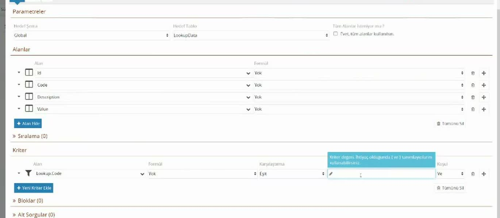
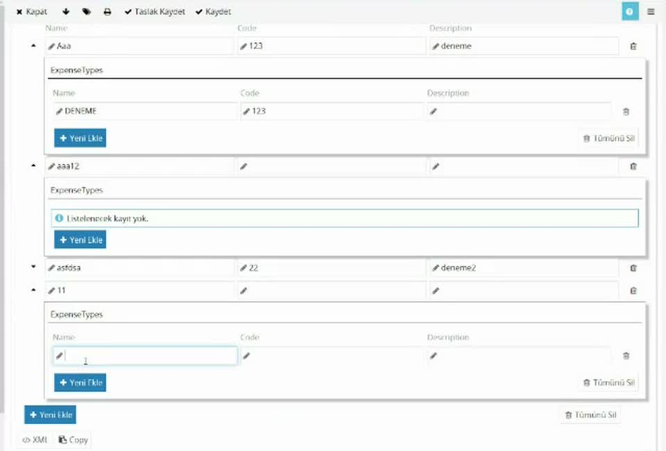

# Örnek: listeleri yöneten ayar ekranı

> **Taslak.** Biçim ve içerik onayı bekliyor.

Formlardaki açılır listelerin içeriği (masraf grupları, masraf tipleri gibi) zamanla değişir. Bunları her seferinde süreç tasarımcısından değiştirmek yerine, yetkili bir kullanıcının kendi başına düzenleyebileceği bir **ayar ekranı** yapabilirsiniz. Bu sayfa öyle bir ekranı baştan sona kurar: gruplar ve her grubun altında tipler veri tabanında tutulur, ekran açıldığında tablodan okunur, **Kaydet**'e basıldığında tabloya yazılır.

Örnek, daha önce ayrı ayrı anlatılan parçaları bir araya getirir: [Tablo düzeninde içerik](/tablo-duzeninde-icerik), [Veritabanı Sorgusu bileşeni](/veritabani-sorgusu), [Scriptte veri tabanı](/scriptte-veri-tabani).

## Veriyi nerede tutacağız

Her küçük liste için ayrı tablo açmak gerekmez. Bu örnekte iki tablo bütün listeleri taşır:

| Tablo | Ne tutar | Alanlar |
|---|---|---|
| `Lookups` | Listelerin kendisi: her liste bir kayıt. | `Id`, `Code`, `Description` |
| `LookupData` | Bütün listelerin öğeleri. | `Id`, `Code`, `Value`, `Description`, `Lookup`, `Parent` |

`LookupData`'daki her kaydın `Lookup` alanı, ait olduğu listenin `Lookups` tablosundaki `Id`'sidir. `Parent` alanı, öğe başka bir öğenin altındaysa (tip → grup) üstündeki öğenin `Id`'sidir. İki tablo arasında `Lookup` adında bir ilişki tanımlıdır (`LookupData.Lookup` → `Lookups.Id`); sorgularda listeyi koduyla seçebilmek için gereklidir. Tablo ve ilişki tanımlama: [Veritabanları](/veritabanlari).

Bu tablolar ürünle hazır gelmez; şemanızda kendiniz açarsınız, adları da size kalmıştır.

Önce listeleri tanımlayın. `Lookups` tablosunun **Veri** sekmesinde **Yeni Kayıt Ekle** ile iki kayıt açın ve **Değişiklikleri Uygula**'ya basın:

| Code | Description |
|---|---|
| `EGL` | Expense Group List |
| `ETL` | Expense Type List |

Kayıt uygulanmadan `Id` kesinleşmez; `Id`'yi bir yere kopyalayacaksanız önce uygulayın.

`LookupData`'da her kaydın `Lookup` alanı dolu olmalıdır. Listeye bakmadan yapılan bir sorgu bütün listelerin öğelerini birbirine karışmış halde getirir.

## Süreç ve veri modeli

1. Yeni bir havuz açın (örnek: `Settings`) ve havuzun **Veri Kökü**'nü bu modele bağlayın.
2. Veri modeli:

```
Settings
└─ ExpenseGroups
   └─ ExpenseGroup        (çoklanan)
      ├─ Id
      ├─ Code
      ├─ Name
      ├─ Description
      └─ ExpenseTypes
         └─ ExpenseType   (çoklanan)
            ├─ Id
            ├─ Code
            ├─ Name
            └─ Description
```

3. Akışta tek görev yeter (örnek: **Ayarlar**). Göreve iki aksiyon ekleyin:

| Aksiyon | Nereye bağlanır | Ne olur |
|---|---|---|
| **Kaydet** | Hiçbir yere | Görev tamamlanır, akış biter. |
| **Taslak Kaydet** | Aynı göreve geri | Form aynı kişinin önünde yeniden açılır; veri tabanına yazılmaz. |

Ekran her açılışta yeni bir akış başlatır ve güncel kayıtları tablodan okur; tamamlanan akışların kendisi bir işe yaramaz, asıl veri tablodadır.

Form açıkken veri modelini değiştirirseniz yeni alanlar formda görünmez. Formu kapatıp yeniden açın.

## Form: grup tablosu

1. Forma bir **Satır Üzerinde İçerik** ekleyip `ExpenseGroups`'a bağlayın.
2. İçine `ExpenseGroup`'u **Tablo Düzeninde İçerik** olarak bırakın; `Name`, `Code`, `Description` sütunlarını ekleyin. `Id` sütun olarak gerekmez.
3. Tablonun **Veri** sekmesinde **Satır No XPath'i**'ne `Id` yazın. Böylece **Yeni Ekle** ile eklenen satır anında bir `Id` alır; az sonra tipleri gruba bağlarken bu `Id` kullanılacak.
4. Tablonun altına bir **Veritabanı Sorgusu** bileşeni ekleyin:

| Ayar | Değer |
|---|---|
| Hedef XPath | boş (bileşen zaten `ExpenseGroups`'un içinde) |
| Öğe XPath'i | `ExpenseGroup` |
| Açılışta sorguyu çalıştır | işaretli |
| Hedef Şema / Hedef Tablo | şemanız / `LookupData` |
| Alanlar | `Id`, `Code`, `Description`, `Value` |
| `Value` alanının **Eşlenen XPath**'i | `Name` (modelde alanın adı `Name` olduğu için) |
| Kriter | `Lookup.Code` **Eşit** `EGL` |



Kriterdeki `Lookup.Code`, alan seçicide `Lookup` ilişkisinin altından seçilir: "bu kaydın bağlı olduğu listenin kodu" demektir. Listenin `Id`'sini yazmak da çalışır ama okunmaz; kod yazmak sorguyu anlaşılır kılar.

Kriter vermezseniz bütün listelerin öğeleri gelir. Sorgu beklediğinizden çok kayıt getiriyorsa eksik olan çoğunlukla bir kriterdir.

## Form: grubun altında tipler

Tipler, ait oldukları grubun satırında görünmelidir. Tablo Düzeninde İçerik'te her satırın başında küçük bir ok vardır; oka basınca satırın altında bir alan açılır. Tasarımcıda bu alana başka bileşenler bırakabilirsiniz.

1. Tasarımcıda grup tablosunun satırındaki oka basın.
2. Açılan alana `ExpenseTypes`'a bağlı bir **Satır Üzerinde İçerik**, onun içine `ExpenseType`'ı **Tablo Düzeninde İçerik** olarak bırakın; `Name`, `Code`, `Description` sütunlarını ekleyin.
3. Aynı alana, tip tablosunun **dışına** ikinci bir **Veritabanı Sorgusu** ekleyin:

| Ayar | Değer |
|---|---|
| Hedef XPath | `ExpenseTypes` |
| Öğe XPath'i | `ExpenseType` |
| Açılışta sorguyu çalıştır | işaretli |
| Alanlar | `Id`, `Code`, `Description`, `Value` (→ `Name`) |
| Kriter 1 | `Lookup.Code` **Eşit** `ETL` |
| Kriter 2 | `Parent` **Eşit** <code v-pre>{{Id}}</code> |

İkinci kriter tipleri gruba bağlar: <code v-pre>{{Id}}</code>, sorgunun bulunduğu satırın, yani grubun `Id`'sidir. Her grubun altında yalnızca `Parent`'ı o grup olan tipler görünür.



Bir grubun tipleri, kullanıcı o satırı okla açtığında okunur.

## Kaydetme: İş Sonrası Script

Görevin **İş Sonrası Script**'i iki tabloyu da yazar. Script yalnızca **Kaydet** aksiyonunda çalışmalıdır; **Taslak Kaydet**'te veri tabanına dokunulmaz.

```js
if ($WorkItem.SelectedAction == 'Kaydet') {

    // Gruplar
    $Database.ImportFromXml({
        "Parameters": { "TargetSchema": "Global", "TargetTable": "LookupData" },
        "XPath": "ExpenseGroups/ExpenseGroup",
        "Columns": [
            { "Name": "Id" },
            { "Name": "Code" },
            { "Name": "Description" },
            { "Name": "Value", "Properties": { "XPath": "Name" } },
            { "Name": "Lookup" }
        ],
        "Map": function () {
            this.Lookup = 'EGL kaydının Id değeri';
        }
    });

    // Tipler
    $Database.ImportFromXml({
        "Parameters": { "TargetSchema": "Global", "TargetTable": "LookupData" },
        "XPath": "ExpenseGroups/ExpenseGroup/ExpenseTypes/ExpenseType",
        "Columns": [
            { "Name": "Id" },
            { "Name": "Code" },
            { "Name": "Description" },
            { "Name": "Value",  "Properties": { "XPath": "Name" } },
            { "Name": "Parent", "Properties": { "XPath": "../../Id" } },
            { "Name": "Lookup" }
        ],
        "Map": function () {
            this.Lookup = 'ETL kaydının Id değeri';
        }
    });
}
```

Sorguları elle yazmazsınız; `$Database.ImportFromXml(` yazıp ipucundaki **Query**'ye tıklayın, pencereyi doldurun. **Özel Eşleştirme Kullanılsın mı?** kutusunu işaretlediğinizde `Map` fonksiyonu boş olarak eklenir; içini script alanında yazarsınız.

Dikkat edilecek yerler:

- **`Lookup` sütunu.** Modelde `Lookup` diye bir alan yoktur; değeri `Map` fonksiyonu verir. `this.Lookup = '…'`, yazılan her kayıt için o sütunu listenin `Id`'sine ayarlar. Sütun **Alanlar** listesinde bulunmalıdır. `Id`'yi `Lookups` tablosunun **Veri** sekmesinden kopyalayın.
- **`Parent` sütunu.** Eşlenen XPath'ler yazılan satıra göredir. `../../Id` iki basamak yukarı çıkar: `ExpenseType` → `ExpenseTypes` → `ExpenseGroup`, sonra onun `Id`'si. Aynı şey `ancestor::ExpenseGroup/Id` diye de yazılabilir; `../../Id` tam olarak tek bir yeri gösterdiği için daha güvenlidir.
- **Tiplerin yolu.** `XPath` baştan sona yazılır (`ExpenseGroups/ExpenseGroup/ExpenseTypes/ExpenseType`). `//ExpenseType` de çalışır ama modelin başka bir yerinde aynı adlı eleman varsa onu da alır ve daha yavaştır.
- **`Id`.** Tablodan okunan satırların `Id`'si doludur; kaydedince aynı kayıt güncellenir, yinelenmez. Yeni satırın `Id`'si formda atanır (grup tablosundaki **Satır No XPath'i** bunun içindir); atanmamışsa kayıt sırasında üretilir.
- **Silme.** Kullanıcı tablodan okunmuş bir satırı çöp kutusuyla silip **Kaydet**'e basarsa kayıt veri tabanından da silinir.

`ImportFromXml`'in ayrıntıları: [Scriptte veri tabanı](/scriptte-veri-tabani). Scripti aksiyona göre çalıştırma: [Akış tasarımı → Scripti yalnızca belirli aksiyonda çalıştırma](/akis-tasarimi#scripti-yalnızca-belirli-aksiyonda-calıstırma).

## Sık yapılan hatalar

| Belirti | Neden | Çözüm |
|---|---|---|
| Kaydettikten sonra kayıtların bir sütunu boşalıyor. | Modelde tutup tabloya yazdığınız bir alanı (örneğin `Lookup`'ı modele koyduysanız) sorgu getirmiyor; alan formda boş kalıyor ve boş olarak geri yazılıyor. | Tabloya yazdığınız her alanı sorgunun **Alanlar** listesine de ekleyin ya da değeri bu sayfadaki gibi `Map` ile verin. |
| Tipler bütün grupların altında görünüyor. | `Parent` kriteri yok. | İkinci kriteri ekleyin. |
| Yeni eklenen grubun tipleri kaydedildikten sonra görünmüyor. | Grup satırının `Id`'si kayıt anında boştu; tiplerin `Parent`'ı boş yazıldı. | Grup tablosunda **Satır No XPath'i**'ne `Id` yazın ya da önce grubu kaydedip tipleri sonra ekleyin. |
| Sorgu hiçbir şey getirmiyor. | `Lookups` tablosunda o kodla kayıt yok ya da kod yanlış yazılmış. | **Veri** sekmesinden denetleyin. |
| Sorgu çok kayıt getiriyor. | Liste kriteri (`Lookup.Code`) eksik. | Kriteri ekleyin. |

## Listeyi başka formlarda kullanma

Aynı tabloyu masraf formundaki açılır listelere kaynak olarak verirsiniz: grup listesi için kriter `Lookup.Code` **Eşit** `EGL`; tip listesi için buna ek olarak `Parent` **Eşit** seçilen grubun değeri. Ayrıntı: [Açılır liste → Veritabanı Sorgusu](/acilir-liste#veritabanı-sorgusu) ve [Birbirine bağlı listeler](/acilir-liste#birbirine-baglı-listeler).

## İlgili sayfalar

- [Veritabanları: şema, tablo ve ilişki](/veritabanlari)
- [Veritabanı Sorgusu bileşeni](/veritabani-sorgusu)
- [Scriptte veri tabanı](/scriptte-veri-tabani)
- [Tablo düzeninde içerik](/tablo-duzeninde-icerik)

---

**Kaynak:** CodEase Eğitim – Atılay, Veri Tabanı (22.04.2022), 05:00–78:00. Videoda eksik ya da belirsiz kalan noktalar ürün davranışına göre tamamlandı.
