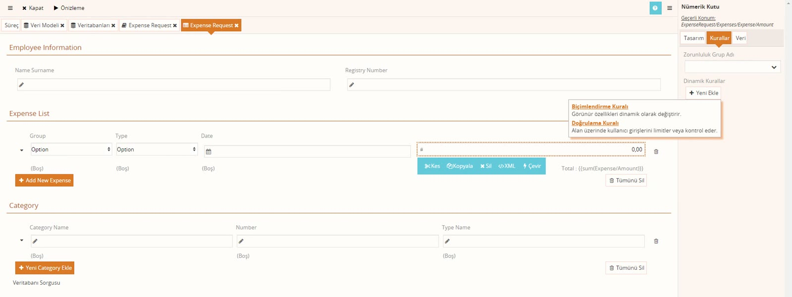
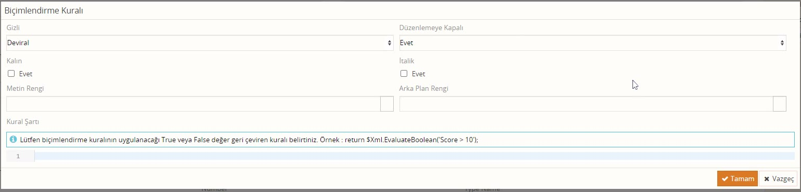

# Dinamik kurallar: biçimlendirme ve doğrulama

> **Taslak.** Biçim ve içerik onayı bekliyor.

Bir alanın görünümünü ya da geçerliliğini formdaki başka bir değere bağlamak için **dinamik kural** yazılır: departman "Genel Müdürlük" ise tutar değiştirilemesin; departman "Satış" ise tarih zorunlu olsun. Bu sayfa iki kural türünü anlatır.

Kural eklemek için bileşeni seçin, **Kurallar** sekmesinde **Dinamik Kurallar** → **Yeni Ekle**'ye basın.



| Kural | Ne yapar |
|---|---|
| Biçimlendirme Kuralı | Koşul doğruyken alanı gizler, düzenlemeye kapatır ya da görünümünü değiştirir. |
| Doğrulama Kuralı | Koşul doğruyken hata mesajı gösterir ve aksiyonu engeller. |

Eklenen kuralın yanındaki kalem simgesi düzenleme penceresini açar.

## Koşulu yazma

İki kuralda da koşul **Kural Şartı** alanına JavaScript olarak yazılır ve sonucu **`return` ile** döndürür:

```js
return $Xml.Evaluate('../Group/Name') == 'Genel Müdürlük';
```

- `$Xml`, kuralın yazıldığı bileşenin bağlı olduğu alandır. Kural `Amount` kutusundaysa `$Xml` `Amount`'tur.
- Başka bir alanı okumak için yolu oradan başlatın. `..` bir üst elemana çıkar: `Amount`'tan `../Group/Name`, aynı satırdaki `Group`'un `Name` alanıdır.
- `$Xml.IsEmpty()` yol vermeden çağrılırsa bileşenin kendi alanının boş olup olmadığına bakar.
- Kurallar formdaki her değişiklikten sonra yeniden hesaplanır; kullanıcı departmanı değiştirdiği anda sonuç ekrana yansır.

`return` yazmayı unutmayın. Form üzerindeki scriptler sonucu `return` ile verir; rol scripti, rota kuralı gibi akış tarafındaki scriptlerde ise `return` yazılmaz. Ayrım için: [İşlem sırası ve hatalar → return ne zaman yazılır](/islem-sirasi-ve-hatalar#return-ne-zaman-yazılır).

## Biçimlendirme Kuralı



Koşul doğruyken uygulanacak biçimleri seçin:

| Ayar | Değerler |
|---|---|
| Gizli | **Deviral** (dokunma), **Evet** (gizle), **Hayır** (göster) |
| Düzenlemeye Kapalı | **Deviral**, **Evet** (yalnızca okunur), **Hayır** (düzenlenebilir) |
| Kalın, İtalik | İşaretlenirse uygulanır |
| Metin Rengi, Arka Plan Rengi | Seçilen renk uygulanır |

Örnek: departman "Genel Müdürlük" seçildiğinde tutar kutusu değiştirilemesin.

1. Tutar kutusunu seçin, **Kurallar** → **Dinamik Kurallar** → **Yeni Ekle** → **Biçimlendirme Kuralı**.
2. **Düzenlemeye Kapalı**'yı **Evet** yapın.
3. **Kural Şartı**'na yukarıdaki koşulu yazın.

Koşul doğru olmadığında alan olağan haline döner.

### Koşullu İçerik mi, Biçimlendirme Kuralı mı

| | Koşullu İçerik | Biçimlendirme Kuralı |
|---|---|---|
| Ne yapar | İçindeki bileşenleri gösterir ya da gizler | Gizler, düzenlemeye kapatır, renk ve yazı biçimi verir |
| Koşul | XPath ifadesi (`Group/Name != 'Genel Müdürlük'`) | JavaScript (`return …;`) |
| Nereye konur | Ayrı bir bileşen; gizlenecek alanlar içine taşınır | Alanın kendi **Kurallar** sekmesine |

Yalnızca göster/gizle gerekiyorsa ve koşul basit bir karşılaştırmaysa **Koşullu İçerik** yeterlidir: [Form tasarımı → Koşullu İçerik](/form-tasarimi#kosullu-icerik). Alanı kapatmak, renklendirmek ya da koşulu script ile hesaplamak gerekiyorsa Biçimlendirme Kuralı kullanın.

## Doğrulama Kuralı

**Zorunluluk Grup Adı** yalnızca "boş mu" diye bakar. Koşula bağlı zorunluluk ya da başka bir denetim (bitiş tarihi başlangıçtan önce olamaz) için Doğrulama Kuralı yazılır.

| Alan | Ne yazılır |
|---|---|
| Doğrulama Grup Adı | Kuralı çalıştıracak aksiyonun **Doğrulama Grubu** ile aynı ad. |
| Hata Mesajı | Kullanıcıya gösterilecek metin. |
| Kural Şartı | Koşul. **Doğru dönerse hata verilir.** |

Koşulun yönüne dikkat edin: kural "geçerli mi" diye değil, "hatalı mı" diye sorar. Örnek: departman "Satış" ise tarih zorunlu olsun.

```js
return $Xml.Evaluate('../Group/Name') == 'Satış' && $Xml.IsEmpty();
```

Kural tarih kutusuna yazılır. Departman "Satış" **ve** tarih boşsa koşul doğrudur; kullanıcı aksiyona bastığında hata mesajını görür ve görev tamamlanmaz.

- Kurallar kullanıcı yazarken değil, **aksiyona basıldığında** denetlenir; yalnızca aksiyonun **Doğrulama Grubu**'ndaki adla eşleşen kurallar çalışır. Grup adlarının işleyişi: [Zorunlu alanlar](/zorunlu-alanlar).
- **Doğrulama Grup Adı**'nı boş bırakmayın; aksiyondaki adla aynı adı yazın.
- Aynı alana hem **Zorunluluk Grup Adı** hem de aynı gruptan bir Doğrulama Kuralı verirseniz ikisi de çalışır ve kullanıcı iki uyarı birden görür. Koşullu zorunlulukta **Zorunluluk Grup Adı**'nı boşaltın.
- Gizli ya da düzenlemeye kapalı alanlarda kurallar denetlenmez.

---

**Kaynak:** Script Eğitimi – Veysel, 38:00–66:00. Videoda eksik ya da belirsiz kalan noktalar ürün davranışına göre tamamlandı.
