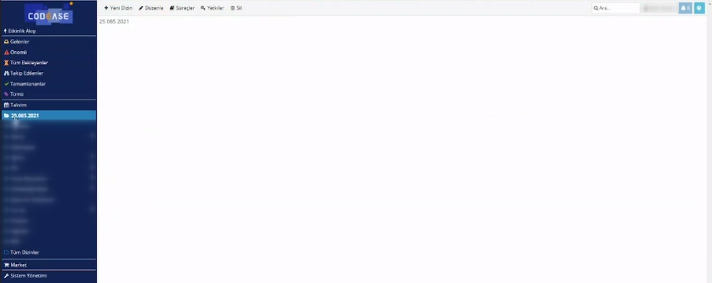
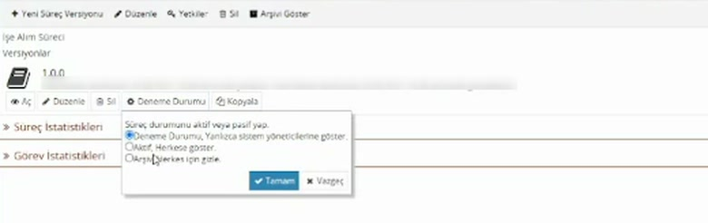
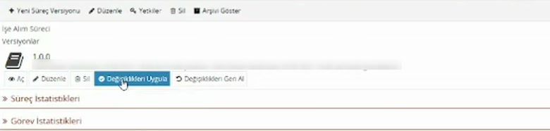
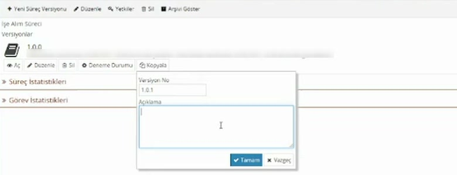

# Dizinler, süreçler ve versiyonlar

> **Taslak.** Biçim ve içerik onayı bekliyor.

CodEase'de süreçler dizinlerin içinde durur. Her sürecin bir ya da daha çok versiyonu vardır; kullanıcılar aynı anda yalnızca bir versiyonu kullanır. Bu sayfa dizin açmayı, süreç oluşturmayı, versiyonları ve bir sürecin kullanıma açılmasını anlatır.

## Dizinler

Sol menünün alt yarısı dizin ağacıdır. Dizinler iç içe olabilir; en altta bütün dizinleri gösteren **Tüm Dizinler** vardır. Bir dizine tıkladığınızda içindeki süreçlerin başlangıç kutucukları ve üstte dizin düğmeleri görünür.

| Düğme | Ne işe yarar |
|---|---|
| Yeni Dizin | Bulunduğunuz dizinin altına yeni bir dizin açar. **Dizin Adı** ve **Dizin Tipi** sorar. |
| Düzenle | Dizinin adını değiştirir. |
| Süreçler | Dizindeki süreçleri listeler; yeni süreç buradan oluşturulur. |
| Yetkiler | Dizine kimin erişebileceğini belirler. |
| Sil | Dizini siler. |

Bu düğmeleri yalnızca dizinde yazma yetkisi olanlar görür.

**Dizin Tipi** iki seçeneklidir: **Uygulama** (içinde süreç bulunan dizin) ve **Doküman** (doküman arşivi). Süreç geliştirecekseniz **Uygulama** seçin; **Süreçler** düğmesi yalnızca bu tipte görünür.

> **Dikkat:** **Sil** yalnızca "silmek istediğinize emin misiniz" diye sorar. Onaylarsanız dizinle birlikte alt dizinler, içlerindeki süreçler, o süreçlerin bütün versiyonları ve başlatılmış bütün akışlar da silinir. Dizinin dolu olması silmeyi engellemez.

### Yetkiler

**Yetkiler** düğmesi **Erişim Kontrol Listesi**'ni açar.

- **Güvenlik Profili:** Tanımlı bir profili seçersiniz ya da **Devir Alma**'yı seçip yetkileri burada tek tek verirsiniz.
- **Ek Yetkiler:** Her satırda bir **Kimlik** (kullanıcı, grup ya da pozisyon) ve yetki düzeyi vardır. İki düzey bulunur: **Okuma** ve **Tümü**.
- Satır ayrıntısında yetkinin **Tip**'ini (**İzin Ver** / **Engelle**) ve isterseniz **Başlangıç Tarihi** ile **Bitiş Tarihi**'ni belirlersiniz.

Bir dizine özel yetki tanımlanmadıysa üst dizinin yetkileri geçerlidir.

## Yeni süreç oluşturma

1. Sürecin duracağı dizine girin ve **Süreçler**'e tıklayın.
2. **Yeni** kutusuna sürecin adını yazıp **Tamam**'a basın.

Süreç **1.0.0** versiyonuyla ve **Deneme Durumu**'nda oluşur; süreç sayfası açılır. İçi boştur: veri modeli, havuz ve form sizin ekleyeceğiniz şeylerdir.

Süreç sayfasının üstündeki düğmeler sürecin bütünüyle ilgilidir: **Yeni Süreç Versiyonu** (boş bir versiyon açar), **Düzenle** (sürecin adını değiştirir), **Yetkiler**, **Sil** ve **Arşivi Göster**.

## Versiyon düğmeleri

Her versiyonun altında kendi düğmeleri vardır.

| Düğme | Ne işe yarar |
|---|---|
| Aç | Versiyonu salt okunur açar. Hiçbir şeyi değiştiremezsiniz; çalışan süreci etkilemeden içine bakmak için kullanılır. |
| Düzenle | Versiyonu değişiklik yapmak üzere açar. |
| Sil | Versiyonu siler. |
| Deneme Durumu / Aktif / Arşiv | Versiyonun o anki durumunu gösterir; tıklayınca durumu değiştirirsiniz. |
| Kopyala | Bu versiyonun kopyasından yeni bir versiyon oluşturur. |

Salt okunur açtığınızda tasarımcının araç çubuğunda kırmızı bir kilit görünür.

> **Dikkat:** Bir versiyonu silmek, o versiyonla başlatılmış akışları ve görevlerini de siler. Versiyonun aktif olması ya da süren akışlarının bulunması silmeyi engellemez.

## Süreç durumu

Durum düğmesine tıklayınca üç seçenek çıkar.

| Durum | Kim görür, ne olur |
|---|---|
| Deneme Durumu | Süreci yalnızca süreçte yazma yetkisi olanlar görür ve başlatabilir. Yeni süreç ve yeni kopya bu durumda başlar. |
| Aktif | Yetkisi olan herkes süreci görür ve başlatır. |
| Arşiv | Sürecin başlangıç kutucukları herkesten gizlenir; versiyon listede de görünmez. |

Ekrandaki seçenek "yalnızca sistem yöneticilerine göster" der; uygulamada belirleyici olan süreçteki yazma yetkisidir.

**Deneme Durumu'nda** başlattığınız akışta formun üstünde bir uyarı çıkar ve sonraki bütün görevler gerçek sahibine değil size gelir. Böylece akışı baştan sona tek başınıza deneyebilirsiniz. Ayrıntısı: [Görev ayarları → Deneme Durumunda atama](/gorev-ayarlari#deneme-durumunda-atama).

**Aktif** yaparken:

- Aynı süreçte yalnızca bir versiyon aktif olabilir. Bir versiyonu aktif yaptığınızda önceki aktif versiyon kendiliğinden arşive geçer.
- Önce bir denetim çalışır; hata bulunursa versiyon aktif yapılamaz.

**Arşivdeki versiyonu geri getirmek için** süreç sayfasının üstündeki **Arşivi Göster**'e tıklayın. Arşivdeki versiyonlar listeye gelir; durum düğmesinden yeniden **Deneme Durumu** ya da **Aktif** yapabilirsiniz.

## Düzenleme ve değişiklikleri uygulama

**Düzenle** ile açtığınız versiyonda yaptığınız her değişiklik kendiliğinden kaydedilir; tasarımcıyı **Kapat** ile kapattığınızda bir şey kaybolmaz. Ama bu değişiklikler henüz bir taslaktır. Versiyon sayfasına döndüğünüzde durum düğmesinin yerinde iki düğme görürsünüz:

- **Değişiklikleri Uygula:** Taslağı versiyona işler.
- **Değişiklikleri Geri Al:** Taslağı atar, versiyon düzenlemeden önceki haline döner. Onay sormaz.

İkisinden birine basana kadar **Kopyala** düğmesi görünmez.

> **Dikkat — aktif versiyonu düzenlemek:** Aktif bir versiyonda **Düzenle**'ye bastığınız anda (henüz hiçbir şey değiştirmeden) versiyon aktif olmaktan çıkar ve normal kullanıcılar süreci başlatamaz. **Değişiklikleri Uygula** ya da **Değişiklikleri Geri Al** dedikten sonra da versiyon **Deneme Durumu**'nda kalır; yeniden **Aktif** yapmanız gerekir.

Bu yüzden kullanımdaki bir süreci değiştirirken aktif versiyona dokunmayın; kopyasında çalışın.

## Kullanımdaki süreci değiştirme: yeni versiyon

1. Aktif versiyonda **Kopyala**'ya basın.
2. **Versiyon No** önerilir; isterseniz değiştirin. Biçim `1.0.1` gibi üç sayıdır ve aynı numara iki kez kullanılamaz. **Açıklama** zorunludur; neyi değiştireceğinizi yazın.
3. Kopya **Deneme Durumu**'nda oluşur. **Düzenle** ile açıp değişikliklerinizi yapın, **Değişiklikleri Uygula** deyin ve deneyin.
4. Hazır olduğunda yeni versiyonu **Aktif** yapın. Eski versiyon kendiliğinden arşive geçer.

Bu sırada kullanıcılar eski versiyonla çalışmayı sürdürür.

## Süreci başka bir ortama taşıma

Bir sürecin bütün tasarımı (veri modeli, akış, formlar, scriptler) tek bir metin olarak alınıp başka bir ortamdaki sürece yapıştırılabilir; örneğin test ortamında hazırlanan süreci canlıya taşımak için.

1. Kaynak ortamda versiyon satırındaki **Aç** düğmesine `Ctrl` tuşu basılıyken tıklayın. **Versiyon İçeriği** penceresi sürecin tasarımını metin olarak gösterir. Metnin tamamını kopyalayın.
2. Hedef ortamda bir süreç ve versiyon oluşturun (ya da var olanı seçin).
3. Hedefteki versiyon satırında **Düzenle** düğmesine `Ctrl` basılıyken tıklayın. Açılan kutudaki metni silip kopyaladığınızı yapıştırın ve **Kaydet**'e basın.
4. **Değişiklikleri Uygula**'ya basın.

- `Ctrl` + **Aç** yalnızca gösterir; hiçbir şeyi değiştirmez. Kullanımdaki bir süreçten kopya alırken bunu kullanın.
- `Ctrl` + **Düzenle** versiyonu düzenlemeye açar. **Aktif** bir versiyonda "Aktif versiyonu düzenliyorsunuz. Devam etmek istediğinize emin misiniz ?" diye sorar; onaylarsanız versiyon kullanıcılara kapanır ve yeniden **Aktif** yapılana kadar süreç başlatılamaz: [Süreç durumu](#surec-durumu).
- Süreç hedef ortamda bulunmayan bir şeye dayanıyorsa (veri tabanı şeması, belirli bir kullanıcı ya da grup kimliği) taşıdıktan sonra bunları hedefte düzeltmeniz gerekir.

## Sonraki adım

Boş sürecin içini doldurma sırası: önce [veri modeli](/veri-modeli), sonra [havuz ve akış](/akis-tasarimi), sonra [form](/form-tasarimi).

---

**Kaynak:** CodEase Eğitim 1 – Fatih, 05:00–17:00 ve 67:00–67:45; Script Eğitimi – Veysel, 158:30–162:00. Videoda eksik ya da belirsiz kalan noktalar ürün davranışına göre tamamlandı.
