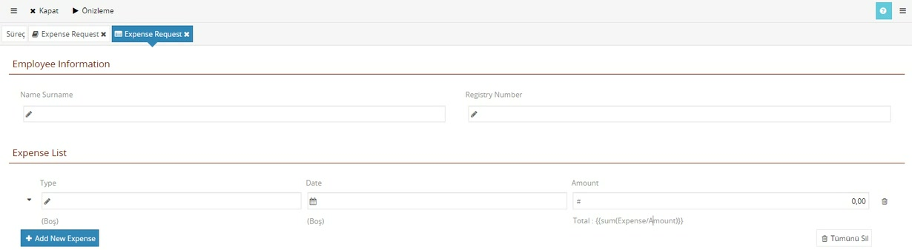
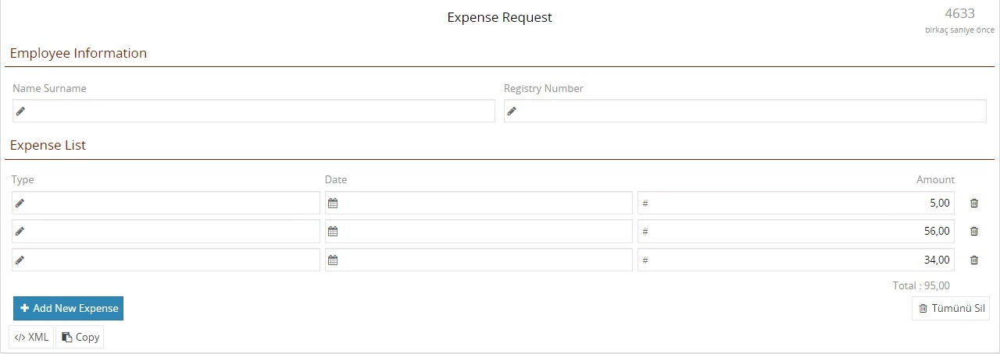

# Etikette hesaplama

::: v-pre

> **Taslak.** Biçim ve içerik onayı bekliyor.

Formdaki bir yazının içine, formdaki veriden hesaplanan bir değer koyabilirsiniz: tablonun altında toplam tutar, başlıkta satır sayısı gibi. Bunun için script yazmanız gerekmez; yazının içine çift süslü parantezle bir ifade koyarsınız.

## Nasıl yazılır

Yazının hesaplanacak kısmını `{{` ve `}}` arasına alın:

```
Total : {{sum(Expense/Amount)}}
```

Parantezlerin dışındaki kısım olduğu gibi gösterilir, içindeki ifade hesaplanıp yerine sonucu yazılır. Kullanıcı formu doldurdukça sonuç kendiliğinden güncellenir.



Formda:



## Örnek: tabloda toplam

Masraf tablosunun altında tutarların toplamını göstermek için:

1. Tabloda **Amount** sütununu seçin.
2. **Tasarım** sekmesinde **Altbilgi** alanına `Total : {{sum(Expense/Amount)}}` yazın.
3. Aynı sekmede **Hizalama**'yı **Sağ** yapın; toplam, sayıların altına hizalanır.

## İfade neye göre yazılır

İfade bir XPath ifadesidir ve yazının bulunduğu bileşenin **Geçerli Konum**'una göre yazılır. Geçerli Konum, bileşeni seçtiğinizde sağ panelin üstünde görünür.

Örnekte tablonun konumu `ExpenseRequest/Expenses`'tır. Toplanacak alan onun altındaki `Expense` satırlarının `Amount` alanıdır; bu yüzden ifade `Expense/Amount` diye yazılır, yolun başı yinelenmez.

- `/` bir alt elemana iner: `Expense/Amount`.
- `*` bütün alt elemanları seçer: `Expense/*`.

## Nerelerde kullanılır

- Satır Düzeninde İçerik'in **Etiket**'i (bölüm başlıkları dahil)
- Tablo sütununun **Etiket**'i ve **Altbilgi**'si
- Sekme başlıkları
- **Etiket** ve **Mesaj** bileşenlerinin metni
- Onay kutusu ve düğme yazıları

İpucu metinlerinde çalışmaz; orada yazdığınız olduğu gibi görünür.

## Kullanılabilen işlevler

| İşlev | Ne verir |
|---|---|
| `sum(yol)` | Toplam |
| `count(yol)` | Kaç tane olduğu |
| `min(yol)`, `max(yol)`, `avg(yol)` | En küçük, en büyük, ortalama |
| `now()` | O anki tarih ve saat |
| `iif(...)`, `format(...)` | Koşula göre değer, biçimlendirme |

Sayılar ve tarihler kullanıcının dil ayarına göre kendiliğinden biçimlenir (örnek: `95,00`).

Koşullu metin için `{{if koşul then … else …}}` biçimi de vardır. `iif`, `format` ve koşullu biçimin ayrıntıları eğitim videolarında henüz anlatılmadı.

---

**Kaynak:** CodEase Eğitim 1 – Veysel, 45:30–51:40. Videoda eksik ya da belirsiz kalan noktalar ürün davranışına göre tamamlandı.

:::
