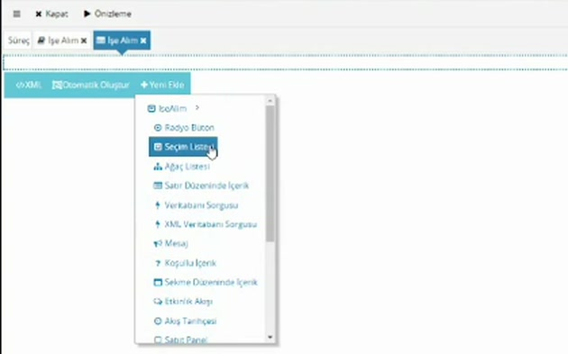
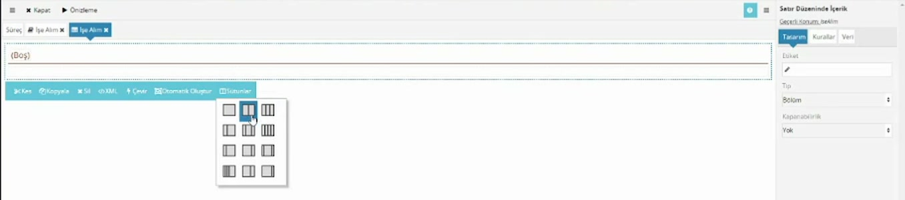
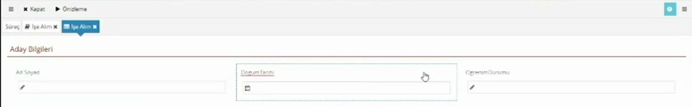

# Form tasarımı

> **Taslak.** Biçim ve içerik onayı bekliyor.

Form, kullanıcının bir görevde gördüğü ve doldurduğu ekrandır. Forma yalnızca [veri modelinde](/veri-modeli) tanımlı alanları ekleyebilirsiniz; önce veri modelini tamamlayın. Bu sayfa form tasarımcısının temelini ve alanları satır ve sütunlara yerleştirmeyi anlatır.

## Formu açma

Havuzun içinde, akış şemasının altındaki **Formlar** başlığında havuzla birlikte oluşmuş bir form bulunur. Tıklayınca form tasarımcısı yeni bir sekmede açılır. Artı düğmesiyle havuza başka formlar ekleyebilirsiniz.

Boş formda en üstte noktalı çizgili bir kutu görünür; bu formun kendisidir. Tıklayınca altında düğmeler çıkar:

| Düğme | Ne işe yarar |
|---|---|
| XML | Formun tanımını metin olarak açar. Alışana kadar kullanmayın; hatalı bir değişiklik bütün formu bozabilir. |
| Otomatik Oluştur | Veri modelindeki bütün alanlardan hazır bir form üretir. |
| Yeni Ekle | Forma tek tek alan ve bileşen eklersiniz. |

Üstteki **Önizleme** formu kullanıcının göreceği haliyle gösterir.

## Otomatik Oluştur

Veri modelindeki alanları sırayla forma dizer. Hızlı bir başlangıçtır; düzeni beğenmezseniz alanları silip elle yerleştirirsiniz.

- Formda bileşen varsa önce "formdaki tüm bileşenleri silmek istediğinizden emin misiniz?" diye sorar ve onaylarsanız **formu baştan kurar.** Elle düzenlediğiniz bir formda basmayın.
- Adı tam olarak `Id` olan elemanları forma koymaz.
- Seçim listesi yapısındaki bölümleri açılır liste, tekrarlayan elemanları tablo olarak ekler.

Aynı düğme satır, tablo ve sekme gibi bileşenlerin üstünde de vardır; orada yalnızca o bileşenin içini doldurur.

## Yeni Ekle

**Yeni Ekle**'ye bastığınızda bir menü açılır.

- En üstte veri modelinin kökü (örnek: `IseAlim`) durur. Yanındaki oka gelince köke bağlı eklenebilecek bileşenler listelenir: **Satır Düzeninde İçerik**, **Sekme Düzeninde İçerik**, **Koşullu İçerik**, **Mesaj**, **Veritabanı Sorgusu** ve diğerleri.
- Altında veri modelindeki alanlar durur (`AdSoyad`, `DogumTarihi`…). Birine tıklarsanız o alan forma eklenir.
- **Etiket** forma sabit bir yazı ekler.

Alan eklenirken bileşen, alanın veri tipine göre kendiliğinden seçilir:

| Veri modelindeki tip | Formdaki bileşen |
|---|---|
| Metin | Metin Kutusu |
| Numara | Nümerik Kutu |
| Tarih, Saat, Tarih Saat | Tarih ve Saat Kutusu (tipe uygun biçimde) |
| İkili Değer | Seçim Kutusu (onay kutusu) |
| Seçim listesi yapısındaki Bölüm | [Açılır Liste](/acilir-liste) |
| Tekrarlayan eleman | [Tablo Düzeninde İçerik](/tablo-duzeninde-icerik) |

Bu yüzden doğum tarihi için ayrıca bir şey yapmanız gerekmez; veri modelinde tipi **Tarih** ise formda tarih seçici olarak gelir.

## Seçili bileşenin düğmeleri

Formdaki bir bileşene tıkladığınızda altında bir düğme çubuğu çıkar.

| Düğme | Ne işe yarar |
|---|---|
| Kes, Kopyala, Yapıştır | Bileşeni formun başka bir yerine taşır ya da çoğaltır. Bir bölümün yerini değiştirmenin yolu budur. **Yapıştır** yalnızca bir şey kesip kopyaladıktan sonra, içine bileşen alabilen yerlerde görünür. |
| Sil | Bileşeni siler; önce onay sorar. |
| XML | Bileşenin tanımını metin olarak açar. |
| Çevir | Bileşeni aynı veriye uyan başka bir bileşen türüne çevirir (örnek: açılır listeyi radyo düğmeye). |
| Otomatik Oluştur, Yeni Ekle | İçine bileşen alabilen bileşenlerde görünür. |

Bileşenleri basılı tutup sürükleyerek de yerlerini değiştirebilirsiniz.

## Özellik paneli

Seçili bileşenin ayarları sağdaki panelde sekmeler halinde durur. Panelin üstünde bileşenin türü ve **Geçerli Konum** (bağlı olduğu veri modeli yolu) yazar.

| Sekme | İçinde ne var |
|---|---|
| Tasarım | Görünüm: etiket, genişlik, hizalama ve bileşene özel görünüm ayarları. |
| Kurallar | [Zorunluluk](/zorunlu-alanlar) ve dinamik kurallar. |
| Veri | Bileşenin veri modelindeki hangi alana bağlı olduğu. |
| Veri Kaynakları | Liste bileşenlerinde seçeneklerin nereden geleceği. |
| Diğer | Tablo gibi tekrarlayan bileşenlerde ekleme, silme ve taşıma izinleri. |

Her bileşende bütün sekmeler bulunmaz; örneğin metin kutusunda **Tasarım**, **Kurallar** ve **Veri** vardır.

## Satır Düzeninde İçerik: alanları yan yana dizme

Alanları doğrudan forma eklerseniz alt alta dizilir. Yan yana koymak ve başlık vermek için **Satır Düzeninde İçerik** kullanılır; formların iskeleti bu bileşendir.

1. **Yeni Ekle** → kökün yanındaki ok → **Satır Düzeninde İçerik**.
2. Satıra tıklayın, düğme çubuğundan **Sütunlar**'a basın ve bir düzen seçin.
3. Her sütuna tıklayıp **Yeni Ekle** ile içine alan koyun.

**Sütunlar** on iki hazır düzen sunar:

| Sütun sayısı | Düzenler |
|---|---|
| 1 | %100 |
| 2 | %50-%50, %33-%67, %67-%33, %25-%75, %75-%25, %83-%17 |
| 3 | %33-%33-%33, %25-%50-%25, %17-%67-%17 |
| 4 | %25-%25-%25-%25, %17-%17-%17-%50 |

Daha az sütunlu bir düzene geçerseniz kaldırılan sütunların içeriği son kalan sütuna taşınır.

Tek bir sütunun genişliğini ayrıca ayarlayabilirsiniz: sütuna tıklayın, **Tasarım** → **Genişlik**. Satır 12 birime bölünmüştür; sütuna 1 ile 12 arasında birim verirsiniz. Aynı sekmedeki **Duyarlı Tasarım** sütunun masaüstü, tablet ve telefonda ayrı genişlikte görünmesini ya da o cihazda gizlenmesini sağlar.

### Dörtten fazla sütun

Hazır düzenler en çok dört sütunludur. Altı ya da sekiz sütun için satırları iç içe koyun: iki sütunlu bir satır ekleyin, her sütununun içine üçer (ya da dörder) sütunlu birer satır daha ekleyin.

### Başlık ve bölüm

Satıra tıklayınca **Tasarım** sekmesinde şunlar görünür:

| Ayar | Ne işe yarar |
|---|---|
| Etiket | Satırın başlığı. Boşsa tasarımcıda `{Boş}` yazar. |
| Tip | **Alan** düz bir satırdır. **Bölüm** başlığı belirginleştirir ve altına çizgi çeker; formu "Aday Bilgileri" gibi bölümlere ayırmak için kullanılır. |
| Kapanabilirlik | Yalnızca **Bölüm** tipinde. **Yok**, **Genişletilmiş** (açık gelir, kapatılabilir) ya da **Kapatılmış** (kapalı gelir, açılabilir). |

### Alan etiketleri

Metin kutusu gibi alanların kendi etiketi yoktur; etiket, alanı saran satıra aittir. Alanı tek başına bir sütuna eklediğinizde etiket veri modelindeki addan gelir (`AdSoyad`, `DogumTarihi`). Kullanıcıya böyle görünmemesi için düzeltin:

- Etiketin üstüne tıklayıp yerinde yazın, ya da
- Satırı seçip **Tasarım** → **Etiket** alanını değiştirin.

## Koşullu İçerik

Formun bir bölümünün yalnızca belirli bir durumda görünmesini istiyorsanız o bölümü **Koşullu İçerik** bileşeninin içine koyun.

1. **Yeni Ekle** → kökün yanındaki ok → **Koşullu İçerik**.
2. Bileşeni seçin, **Kurallar** sekmesindeki **Koşul** alanına koşulu yazın (örnek: `Musteri/Id = '3'`).
3. Gösterilecek alanları bileşenin içine ekleyin.

Koşul bir XPath ifadesidir, script değildir. Bileşenin **Geçerli Konum**'una göre yazılır. Koşul doğruyken içerik görünür, değilken gizlenir; kullanıcı koşuldaki alanı değiştirdiği anda sonuç ekrana yansır.

Alanı gizlemek yerine düzenlemeye kapatmak ya da renklendirmek için: [Dinamik kurallar](/dinamik-kurallar).

## Kırmızı görünen bileşen

Bir bileşenin bağlı olduğu alan veri modelinde artık yoksa (silinmiş ya da yeri değişmişse) bileşen tasarımcıda kırmızı görünür. Bileşeni silip alanı yeni yerinden yeniden ekleyin.

## Formu deneme

Süreç **Deneme Durumu**'ndayken sürecin dizinindeki başlangıç kutucuğuna tıklayın; form kullanıcının göreceği haliyle açılır. Tasarımda değişiklik yaptıktan sonra bu sayfayı yenileyin.

Formun altındaki **XML** düğmesi girdiğiniz verinin veri modelinde nereye yazıldığını gösterir ([Veri modeli → Veriyi görme](/veri-modeli#veriyi-gorme)).

## İlgili sayfalar

- [Açılır liste](/acilir-liste)
- [Tablo düzeninde içerik](/tablo-duzeninde-icerik)
- [Zorunlu alanlar](/zorunlu-alanlar)
- [Görev ayarları → Form bölümlerini göreve göre gizleme ve kapatma](/gorev-ayarlari#form-bolumlerini-goreve-gore-gizleme-ve-kapatma)

---

**Kaynak:** CodEase Eğitim 1 – Fatih, 35:30–50:00; CodEase Eğitim 4 – Fatih, 00:00–01:20 ve 12:00–13:30; CodEase Eğitim 8 – Fatih, 45:00–49:40. Videoda eksik ya da belirsiz kalan noktalar ürün davranışına göre tamamlandı.
