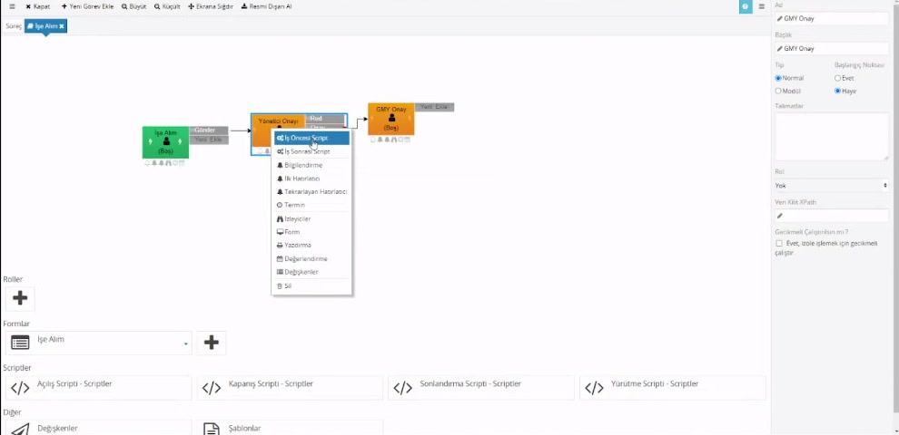
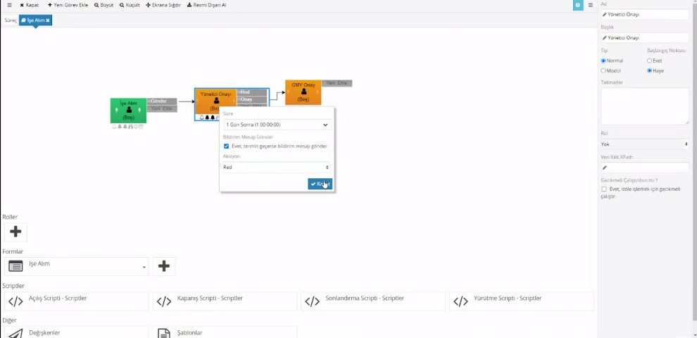
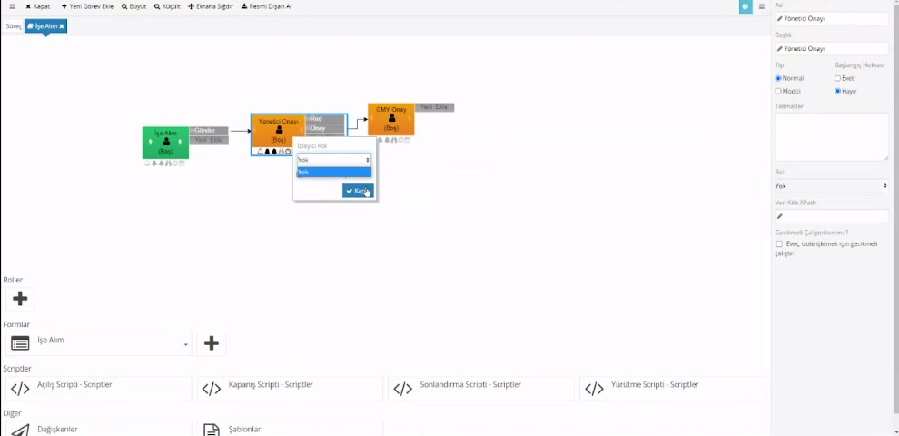
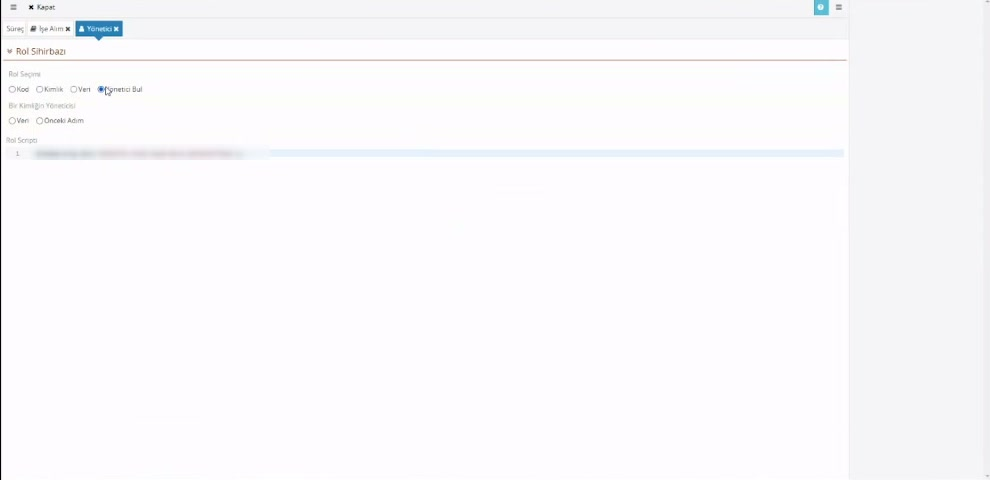
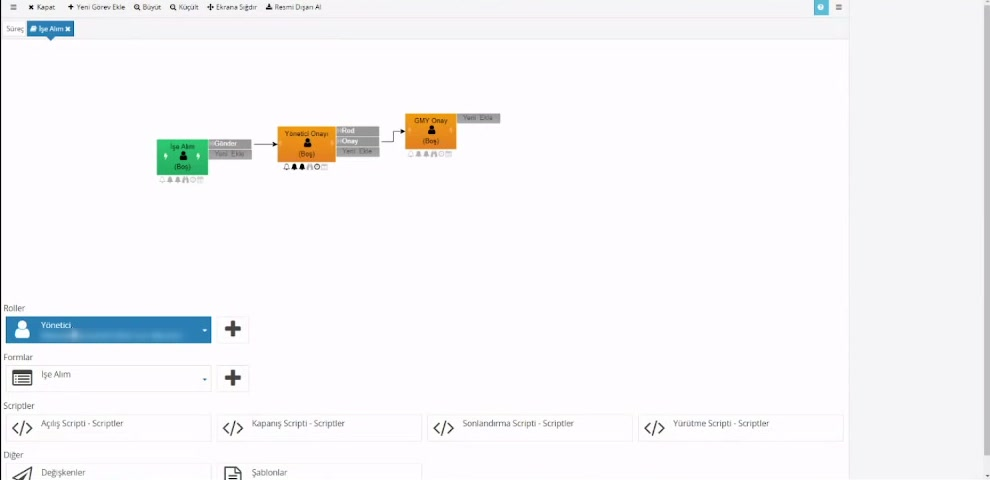
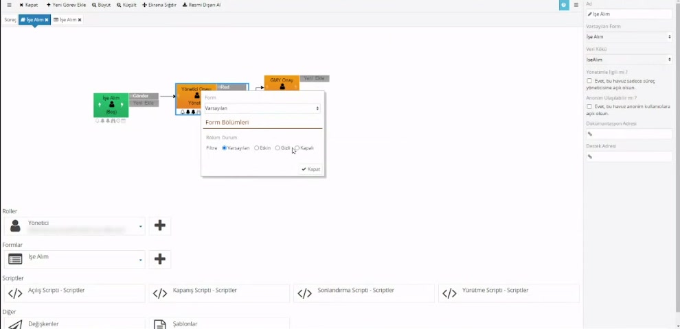
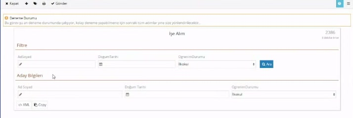
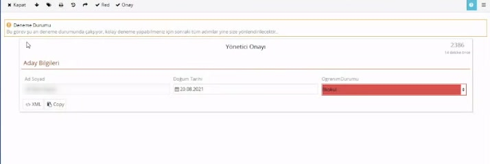
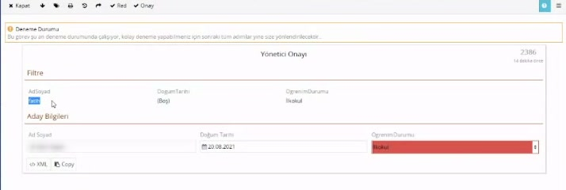
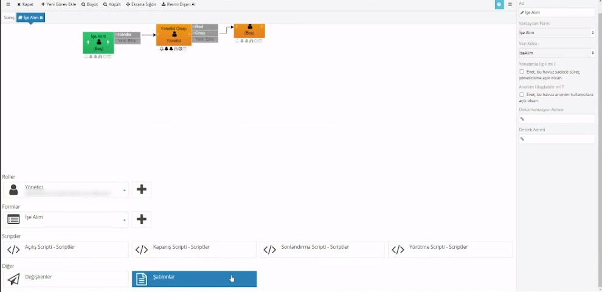

# Görev ayarları

> **Taslak — örnek sayfa.** Biçim ve içerik onayı bekliyor.

Süreç tasarımcısında bir görevin kime atanacağını, atanan kişiye ne zaman e-posta gideceğini, süre dolunca ne olacağını ve formun o görevde nasıl görüneceğini görev üzerinden ayarlarsınız. Bu sayfa o ayarları anlatır.

Ayarların iki yeri vardır:

- **Sağ tık menüsü:** Akış şemasında göreve sağ tıklayınca açılır.
- **Özellik paneli:** Göreve sol tıklayınca ekranın sağında açılır. **Rol** buradadır.

## Sağ tık menüsünde neler var

| Menü | Ne işe yarar |
|---|---|
| İş Öncesi Script / İş Sonrası Script | Görev başlamadan önce ve tamamlandıktan sonra çalışacak script. |
| Bilgilendirme | Görev atandığında atanan kişiye e-posta gönderir. |
| İlk Hatırlatıcı | Görev bekliyorsa belirlenen süre sonunda bir kez hatırlatma e-postası gönderir. |
| Tekrarlayan Hatırlatıcı | İlk hatırlatıcıdan sonra, görev tamamlanana kadar belirli aralıkla hatırlatmayı sürdürür. |
| Termin | Süre dolunca görevi seçtiğiniz aksiyonla kendiliğinden tamamlar ya da gecikmiş olarak işaretler. |
| İzleyiciler | Görevi yapmayacak ama takip edecek kişileri belirler. |
| Form | Görevde hangi formun açılacağını ve form bölümlerinin durumunu belirler. |
| Yazdırma | Formun yazdırılmasına izin verir, yazdırma şablonlarını seçer. |
| Değerlendirme, Değişkenler | Bu sayfada anlatılmıyor. |
| Sil | Görevi siler. |

Bilgilendirme, hatırlatıcılar, İzleyiciler, Form ve Yazdırma yalnızca **Normal** tipteki (bir kullanıcının yaptığı) görevlerde görünür. Tipi **Modül** olan görevlerde menünün başında ayrıca **Modül** seçeneği çıkar.

Bir ayarı açtığınızda görev kutusunun altındaki küçük simgelerden ilgili olan koyulaşır; hangi görevde ne açık, şemadan görebilirsiniz.

## Bilgilendirme

**Bildirim Mesajı Gönder** kutusunu işaretlerseniz görev birine atandığı anda o kişiye e-posta gider.

- Rol bir grubu ya da pozisyonu gösteriyorsa e-posta o gruptaki herkese gider.
- Görevi vekâleten devralan kişi varsa ona da gider.
- Sürecin **başlangıç görevinde bildirim gönderilmez.** Süreci başlatan kişi zaten ekranın başındadır.
- Süreçte mesaj şablonu tanımlıysa buradan hangi şablonun kullanılacağını seçebilirsiniz; seçmezseniz **Varsayılan Şablon** kullanılır.

## Hatırlatıcılar

### İlk Hatırlatıcı

Görev atandıktan sonra seçtiğiniz süre kadar bekler. Görev hâlâ bekliyorsa atanan kişilere **bir kez** hatırlatma e-postası gönderir.

Süre seçenekleri: **Kapalı**, **30 Dakika Sonra**, **1 Saat Sonra**, **3 Saat Sonra**, **1 Gün Sonra**, **3 Gün Sonra**. Listede olmayan bir süre için `gün.saat:dakika:saniye` biçiminde kendi değerinizi yazabilirsiniz (örnek: `2.00:00:00` iki gün).

### Tekrarlayan Hatırlatıcı

İlk hatırlatıcı gönderildikten sonra devreye girer ve görev tamamlanana kadar seçtiğiniz aralıkla hatırlatmayı yineler.

- **İlk Hatırlatıcı Kapalı ise Tekrarlayan Hatırlatıcı hiç çalışmaz.** Tekrarlayan hatırlatma istiyorsanız ikisini birlikte ayarlayın.
- Aralık en az 30 dakikadır; daha kısa bir değer yazsanız da 30 dakika uygulanır.
- İkinci hatırlatmanın konusu `R:`, sonrakilerin konusu `RR:` ile başlar.

**Örnek:** İlk Hatırlatıcı 3 gün, Tekrarlayan Hatırlatıcı 1 gün ise ilk e-posta 3. günde, sonrakiler 4., 5., 6. günde… gider.

> Kurumunuzda çalışma takvimi tanımlıysa hatırlatıcı ve termin süreleri çalışma saatlerine göre sayılır.

## Termin

Görev için bir son süre koyar. Süre, görev başına bir kez işler.

| Alan | Açıklama |
|---|---|
| Süre | Hatırlatıcılardaki listenin aynısı. |
| Bildirim Mesajı Gönder | İşaretliyse termin geçtiğinde atanan kişilere e-posta gider (konu `D:` ile başlar). Varsayılan olarak işaretlidir. |
| Aksiyon | Termin geçince ne olacağı. |

**Aksiyon** alanında iki yol vardır:

- **Görevin aksiyonlarından biri** (örneğin *Red*): Süre dolunca görev o aksiyonla kendiliğinden tamamlanır ve akış o aksiyonun yolundan devam eder.
- **Birşey Yapma:** Görev kişinin listesinde kalır, yalnızca gecikmiş olarak işaretlenir.

**Örnek:** Yönetici Onayı görevinde Süre *1 Gün Sonra*, Aksiyon *Red* ise yönetici bir gün içinde karar vermezse talep kendiliğinden reddedilir.

### Termin ile bilgilendirme görevi

Birine yalnızca haber vermek istiyorsanız (örnek: "masrafınız ödendi") ayrı bir e-posta scripti yazmanız gerekmez:

1. Akışın sonuna bir görev ekleyin, tek bir aksiyon verin (örnek: *OK*) ve rolünü haber verilecek kişiler yapın.
2. Görevde **Bilgilendirme**'yi açın. E-postanın gövdesinde görevin **Talimatlar** alanına yazdığınız metin yer alır.
3. **Termin**'de **Süre**'ye `00:00:01` (bir saniye) yazın, **Aksiyon** olarak *OK*'i seçin.

Görev atanır, bilgilendirme e-postası gider ve termin dolunca görev *OK* aksiyonuyla kendiliğinden kapanır; kimsenin listesinde beklemez. Kapanma tam bir saniyede olmaz: terminler yaklaşık dakikada bir denetlenir ve çalışma takvimi tanımlıysa mesai dışında bir sonraki çalışma saatine kalabilir.

## İzleyiciler

Görevi yapmayacak ama haberdar olması gereken kişiler içindir. **İzleyici Rol** alanından bir rol seçersiniz.

İzleyiciler:

- Görevi **Takip Edilenler** listesinde görür; **Gelenler** kutusuna düşmez.
- Görevi açabilir ama salt okunur görür, aksiyon alamaz.
- **Bildirim Mesajı Gönder** işaretliyse görev atandığında bilgi e-postası alır (konu `W:` ile başlar).

## Görev kime atanır: Rol

Görevin adı (*Yönetici Onayı* gibi) yalnızca bir addır; görevin kime gideceğini **rol** belirler.

### 1. Rolü tanımlayın

Süreç sayfasının altındaki **Roller** bölümünde **+** düğmesine basın, role bir ad verin. **Rol Sihirbazı** dört seçenek sunar:

| Rol Seçimi | Görev kime gider |
|---|---|
| Kimlik | Seçtiğiniz kullanıcıya ya da gruba. |
| Veri | Formdaki bir alanda yazan kişiye. |
| Yönetici Bul | Bir kişinin yöneticisine. Kişi ya formdaki bir alandan (**Veri**) ya da bir önceki adımı tamamlayandan (**Önceki Adım**) alınır. |
| Kod | Kendi yazdığınız script'in döndürdüğü kişiye. |

Sihirbazda yaptığınız seçim, altındaki **Rol Scripti** kutusuna yazılır. Göreve kimin atanacağını bu kutudaki script belirler; sihirbaz yalnızca onu sizin yerinize doldurur. Sihirbazın yazdığı scriptler ve kendi scriptinizi yazma: [Rol scriptleri](/rol-scriptleri).

### 2. Rolü göreve bağlayın

Göreve sol tıklayın, sağdaki panelde **Rol** alanından rolü seçin.

### Rol seçilmezse ne olur

- **Rol *Yok* ise** görev süreci başlatan kişiye atanır.
- Rol tanımlı ama **kimseyi bulamıyorsa** (örneğin formdaki alan boşsa) görev atanamaz ve akış hata verir.

### Deneme Durumunda atama

Süreç sürümü **Deneme Durumu**ndayken görevler rolde kim yazarsa yazsın **denemeyi yapan kişiye** yönlendirilir; bildirim e-postaları da ona gider. Böylece akışı tek başınıza baştan sona deneyebilirsiniz. Ekranın üstünde bunu hatırlatan bir uyarı görünür.

Roller deneme sırasında da çalıştırılır: kimseyi bulamayan bir rol denemede de hata verir. Görev size gelse de akışın **tarihçesinde** görevin gerçekte kime atanacağı yazar; rolün doğru kişiyi bulduğunu sürümü aktif yapmadan oradan denetleyebilirsiniz.

| Sürüm durumu | Kim görür |
|---|---|
| Deneme Durumu | Yalnızca süreçte yazma yetkisi olanlar. |
| Aktif | Erişimi olan herkes. |
| Arşiv | Kimse. |

Durumların ayrıntısı: [Dizinler, süreçler ve versiyonlar → Süreç durumu](/dizinler-ve-surecler#surec-durumu).

## Form bölümlerini göreve göre gizleme ve kapatma

Aynı form her görevde açılır, ama bir bölümün her görevde görünmesi gerekmeyebilir. Örnek: *Filtre* bölümü başlangıç görevinde arama yapmak için gerekir, onay görevlerinde gerekmez.

### 1. Bölüme ad verin

Form tasarımcısında bölümü oluşturan satır düzenini seçin. Sağdaki ayarlarda **Kurallar** sekmesindeki **Bölüm Adı** alanına bir ad yazın (örnek: `Filtre`).

### 2. Görevde bölümün durumunu seçin

Süreç tasarımcısında göreve sağ tıklayıp **Form**'u açın. Ad verdiğiniz bölümler **Form Bölümleri** altında listelenir.

| Durum | Görevde bölüm nasıl görünür |
|---|---|
| Varsayılan | Formda nasıl tasarlandıysa öyle. |
| Etkin | Düzenlenebilir açılır; içinde bulunduğu alan kapalı olsa bile. Bölümün kendi form kuralları varsa onlar yine uygulanır. |
| Gizli | Hiç görünmez. |
| Kapalı | Görünür ama değiştirilemez. |

Başlangıç görevinde *Filtre* bölümü açık:

Yönetici Onayı görevinde *Filtre* **Gizli**:

Yönetici Onayı görevinde *Filtre* **Kapalı**: alanlar okunuyor ama değiştirilemiyor, **Ara** düğmesi de görünmüyor.

Aynı pencerede iki ayar daha vardır:

- **Form:** Havuzda birden fazla form varsa bu görevde hangisinin açılacağı.
- Bölüm ayarlarını başka bir görevden devralma: aynı ayarları her görevde yeniden yapmamak için.

Bir görev salt okunur açıldığında (örneğin izleyici açtığında) gizli olmayan tüm bölümler **Kapalı** gibi davranır.

## Yazdırma

Görev ekranında, aksiyon düğmelerinin solundaki yazıcı simgesi formu yazdırır.

- **Bu formu yazdır** yalnızca formu yazdırır; menüler ve yan paneller çıktıya girmez.
- Yazdırma tarayıcının yazdırma penceresiyle yapılır. PDF almak için o pencerede hedef olarak *PDF olarak kaydet*'i seçin.

Tasarımcıda göreve sağ tıklayıp **Yazdırma**'yı açtığınızda iki ayar vardır:

| Ayar | Açıklama |
|---|---|
| Form Çıktısına İzin Ver | Kapatırsanız bu görevde form yazdırılamaz. Varsayılan olarak açıktır. |
| Yazdırma Şablonları | Seçtiğiniz her şablon, görev ekranındaki yazıcı menüsünde ayrı bir seçenek olarak çıkar. |

Şablonlar süreç sayfasının altındaki **Diğer → Şablonlar** bölümünde tanımlanır. Aynı şablonlar bildirim e-postalarında da kullanılır.

## Görevi silme

Sağ tık menüsünden **Sil**'i seçtiğinizde onay istenir. Onaylarsanız görevle birlikte:

- görevin kendi aksiyonları ve onlardan çıkan oklar,
- başka görevlerden bu göreve gelen oklar

da silinir.

---

**Kaynak:** CodEase Eğitim 2 – Fatih, 03:08–17:00. Videoda eksik ya da belirsiz kalan noktalar ürün davranışına göre tamamlandı.
