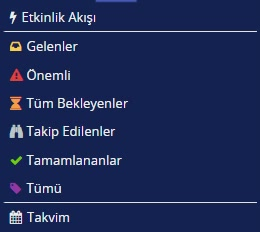

# İş listeleri

> **Taslak.** Biçim ve içerik onayı bekliyor.

Size atanan görevler sol menünün üst kısmındaki listelerde görünür. Bir e-posta kutusu gibi çalışır: yapmanız gereken işler gelir, tamamladıklarınız ayrı bir listeye geçer.

| Liste | İçinde ne var |
|---|---|
| Gelenler | Size atanmış ve sizi bekleyen görevler. Vekâleten size devredilenler de buraya düşer. |
| Önemli | Bekleyen görevlerinizden önemli olarak işaretlenenler. |
| Tüm Bekleyenler | Hangi listede ya da etikette olursa olsun, sizi bekleyen bütün görevler; en yeni en üstte. |
| Takip Edilenler | Yapmayacağınız ama izleyici olarak eklendiğiniz görevler. Açabilirsiniz, aksiyon alamazsınız. |
| Tamamlananlar | Tamamladığınız görevler; en son tamamlanan en üstte. |
| Tümü | Bekleyen ve tamamlanan bütün görevleriniz. |

Kendi etiketlerinizi tanımladıysanız onlar da bu listelerin arasında görünür.

## Gelenler ile Tüm Bekleyenler arasındaki fark

Bir görevi **Gelenler**'den kendi etiketlerinizden birine taşıdığınızda görev **Gelenler**'den çıkar ama hâlâ sizi beklemektedir. **Tüm Bekleyenler** bu görevleri de gösterir. Hiçbir görevi taşımadıysanız iki liste aynı görevleri içerir.

## Bir görev nasıl gelir, nasıl gider

1. Biri akışta bir aksiyon alır (örnek: insan kaynakları **Gönder**'e basar) ve sıradaki görev size atanır. Görev **Gelenler**'de görünür.
2. Görevi açar, formu doldurur ve üstteki aksiyon düğmelerinden birine basarsınız (örnek: **Onay**).
3. Görev **Gelenler**'den çıkar ve **Tamamlananlar**'a geçer; ne yaptığınızı oradan yeniden görebilirsiniz.

Yeni bir akışı kendiniz başlatmak için sol menüden sürecin bulunduğu dizine girin ve başlangıç kutucuğuna tıklayın.

---

**Kaynak:** CodEase Eğitim 1 – Fatih, 05:00–09:00. Videoda eksik ya da belirsiz kalan noktalar ürün davranışına göre tamamlandı.
