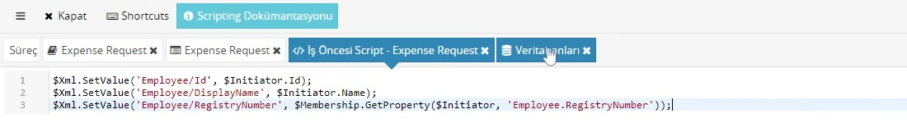
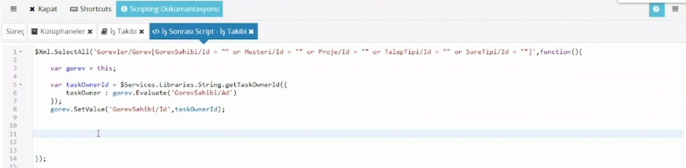

# İş Öncesi ve İş Sonrası Script

> **Taslak.** Biçim ve içerik onayı bekliyor.

Her görevde iki script yeri vardır. Formu kullanıcı açmadan doldurmak, bir aksiyondan sonra kayıt yapmak gibi işler buraya yazılır. Bu sayfa iki scriptin ne zaman çalıştığını ve en sık kullanılan örneği, formu başlatan kişinin bilgileriyle doldurmayı anlatır.

## Ne zaman çalışırlar

| Script | Ne zaman çalışır |
|---|---|
| İş Öncesi Script | Görev oluşurken; rol hesaplanmadan, görev kimseye atanmadan ve bildirim gitmeden önce. |
| İş Sonrası Script | Kullanıcı görevi bir aksiyonla tamamladıktan sonra, akış sonraki göreve geçmeden önce. |

**Başlangıç görevinde** İş Öncesi Script, kullanıcı dizindeki başlangıç kutucuğuna tıkladığında çalışır. Scriptin yazdığı değerler açılan formda dolu görünür.

Scripti açmak için göreve sağ tıklayıp **İş Öncesi Script** ya da **İş Sonrası Script**'i seçin. Görev kutusunun iki yanındaki şimşek simgeleri bu scriptleri gösterir; script yazılmışsa simge koyulaşır.

Scriptler JavaScript'tir ve büyük-küçük harfe duyarlıdır. Düzenleyicide `Ctrl` + `Boşluk` kullanılabilir nesneleri listeler; araç çubuğundaki **Shortcuts** diğer kısayolları, **Scripting Dokümantasyonu** başvuru sayfasını açar.

## Örnek: formu başlatan kişinin bilgileriyle doldurma

Masraf talebinde çalışanın adını ve sicil numarasını kullanıcıya yazdırmak gereksizdir; süreci kimin başlattığı bellidir. Veri modelinde `Employee` bölümünün altında `Id`, `DisplayName` ve `RegistryNumber` alanları varsa, başlangıç görevinin **İş Öncesi Script**'ine şunu yazın:

```js
$Xml.SetValue('Employee/Id', $Initiator.Id);
$Xml.SetValue('Employee/DisplayName', $Initiator.Name);
$Xml.SetValue('Employee/RegistryNumber', $Membership.GetProperty($Initiator, 'Employee.RegistryNumber'));
```



Kullanıcı formu açtığında bu üç alan dolu gelir.

### `$Xml.SetValue(yol, değer)`

Form verisindeki bir alana değer yazar.

- Yol, havuzun **Veri Kökü**'nden başlar. Kökün adını (`ExpenseRequest`) yola **yazmayın**; `Employee/Id` yeterlidir. Kök adıyla başlayan yol scriptin hata vermesine yol açabilir.
- Yol hiçbir alanı göstermiyorsa (ad yanlış yazılmışsa) hiçbir şey olmaz ve hata da çıkmaz. Değer forma gelmiyorsa önce yolu denetleyin; formun altındaki **XML** düğmesi alanların gerçek adlarını gösterir.
- Yalnızca alan boşsa yazmak için `$Xml.SetDefaultValue(yol, değer)` kullanılır.

### `$Initiator`

Süreci başlatan kişidir. Dört özelliği vardır:

| Özellik | Ne verir |
|---|---|
| `$Initiator.Id` | Kişinin sistemdeki numarası. |
| `$Initiator.Name` | Görünen adı (ad soyad). |
| `$Initiator.Type` | Kimliğin türü. |
| `$Initiator.Domain` | Bağlı olduğu alan. |

E-posta ya da sicil numarası gibi bilgiler burada yoktur; onları `$Membership.GetProperty` ile alırsınız.

### `$Membership.GetProperty(kimlik, özellik)`

Bir kimliğin kayıtlı bir özelliğini verir. Kullanıcılar için hazır adlar:

| Özellik adı | Ne verir |
|---|---|
| `Name`, `Surname` | Ad, soyad |
| `DisplayName` | Görünen ad |
| `EMailAddress` | E-posta adresi |
| `RegistryNumber` | Sicil numarası |
| `Language` | Dil |

E-posta için ad `EMailAddress`'tir, `Email` değil.

Noktalı adlar kullanıcı kaydından ilişkili kayda geçer: `'Employee.RegistryNumber'`, kullanıcının çalışan kaydındaki sicil numarasıdır. Kısa `'RegistryNumber'` adı da aynı değeri verir.

## Doldurulan alanları değiştirilemez yapma

Scriptin doldurduğu bilgileri kullanıcının değiştirmemesi gerekir. Bunun için script yazmazsınız:

1. Formda alanları saran satırı seçin, **Kurallar** sekmesinde **Bölüm Adı** verin (örnek: `EmployeeInformation`).
2. Akış şemasında göreve sağ tıklayıp **Form**'u seçin ve o bölümü **Kapalı** yapın.

Aynı yolla masraf listesini yönetici ve muhasebe görevlerinde kapatırsınız; talebi giren doldurur, sonrakiler yalnızca görür. Ayrıntısı: [Görev ayarları → Form bölümlerini göreve göre gizleme ve kapatma](/gorev-ayarlari#form-bolumlerini-goreve-gore-gizleme-ve-kapatma).

## Tekrarlayan satırları dolaşma

Tablodaki her satır için bir iş yapmak gerektiğinde `$Xml.SelectAll` kullanılır. Verdiğiniz yola uyan her eleman için yazdığınız fonksiyonu bir kez çalıştırır.

```js
$Xml.SelectAll('Gorevler/Gorev', function () {

    var gorev = this;

    var ad = gorev.Evaluate('GorevSahibi/Ad');
    gorev.SetValue('Aciklama', ad + ' tarafından girildi');
});
```



- Fonksiyonun içinde `this` o anki satırdır. `this.Evaluate(yol)` satırdaki bir alanı okur, `this.SetValue(yol, değer)` yazar; yollar **satıra göre** yazılır (`GorevSahibi/Ad`), baştaki `Gorevler/Gorev` yinelenmez.
- Yola koşul ekleyerek yalnızca gereken satırları dolaşabilirsiniz: `'Gorevler/Gorev[GorevSahibi/Id = "" or Musteri/Id = ""]'`, görev sahibi ya da müşteri numarası boş olan satırlar demektir. Zaten dolu satırlar için boşuna iş yapılmaz.

Aynı türden sık kullanılan diğer işlevler:

| İşlev | Ne yapar |
|---|---|
| `$Xml.Evaluate(yol)` | Alanın değerini metin olarak verir. |
| `$Xml.EvaluateNumber(yol)` | Değeri sayı olarak verir. |
| `$Xml.Count(yol)`, `$Xml.Sum(yol)` | Yola uyan elemanların sayısı, değerlerinin toplamı. |
| `$Xml.IsEmpty(yol)` | Alan boşsa doğru. |
| `$Xml.HasNode(yol)` | Yola uyan eleman varsa doğru. |
| `$Xml.SelectSingle(yol)` | Yola uyan ilk eleman. |
| `$Xml.AppendChild(yol)` | Yeni eleman ekler (tabloya satır eklemek için). |
| `$Xml.Remove(yol)` | Yola uyan elemanları siler. |

## Hata ayıklama

### Bir değeri görmek için `throw`

Scriptin bir noktasındaki değeri görmek istediğinizde onu `throw` ile fırlatın:

```js
throw taskOwnerId;
```

Aksiyonu aldığınızda fırlatılan değer ekranda hata olarak görünür, script orada durur ve **yaptığı her şey geri alınır**: form verisindeki değişiklikler kaydedilmez, akış ilerlemez, görev açık kalır. Değeri gördükten sonra satırı silmeyi unutmayın.

Bunu **Deneme Durumu**'nda yapın. Aktif bir süreçte İş Sonrası Script, kullanıcı aksiyonu aldıktan sonra arka planda çalışır; hata kullanıcının ekranına düşmez. Hatanın aktif süreçte de anında görünmesi yalnızca aksiyonun özelliklerinde **İşlemi Takip Et** işaretliyse olur.

Aynı yöntem kullanıcıya bilerek hata göstermek için de kullanılır: bir koşul sağlanmıyorsa açıklayıcı bir metin fırlatıp aksiyonu durdurabilirsiniz (aynı koşulla: aksiyonda **İşlemi Takip Et** işaretli olmalıdır).

### `console`

Scriptte `console.info(değer)` yazarsanız çıktı, scripti tetikleyen kullanıcının tarayıcısında geliştirici konsoluna (`F12`) düşer. Script durmaz; birkaç değeri art arda izlemek için `throw`'dan kullanışlıdır.

| İşlev | Konsolda |
|---|---|
| `console.info(…)` | Bilgi satırı |
| `console.warn(…)` | Uyarı simgesiyle |
| `console.error(…)` | Hata simgesiyle. Yalnızca görünümü farklıdır; scripti durdurmaz. |
| `console.log(…)` | Ayrıntı düzeyinde. Tarayıcı konsolunda "Verbose" düzeyi kapalıysa görünmez; `console.info` kullanın. |

Çıktı tarayıcıya yalnızca script kullanıcı beklerken çalışıyorsa düşer: **Deneme Durumu**'nda, **İşlemi Takip Et** işaretli aksiyonlarda ve akış başlatılırken çalışan scriptlerde. Arka planda işlenen adımlarda çıktı tarayıcıya gelmez; **Arkaplan İş Yöneticisi**'nde işin **Log** sekmesine yazılır. Ayrıntı: [İşlem sırası ve hatalar](/islem-sirasi-ve-hatalar).

## Scriptte kullanılabilen başlıca nesneler

| Nesne | Ne için |
|---|---|
| `$Xml` | Form verisini okuma ve yazma (`Evaluate`, `SetValue`, `Count`, `Sum`…). |
| `$WorkItem` | O anki görev: `SelectedAction`, `Previous`, `CompletedBy`… |
| `$Instance` | Akışın kendisi: numarası, başlatanı. |
| `$Initiator` | Süreci başlatan kişi. |
| `$Membership` | Organizasyon sorguları: kimlik, yönetici, özellik. |
| `$Database` | Süreçte tanımlı veri tabanlarında sorgu ve kayıt. |
| `$Messages` | Mesaj ve e-posta gönderme. |
| `$Services` | Süreçte tanımlı web servisleri. |

Bu sayfa yalnızca eğitimde gösterilenleri anlatır. `$Database` için: [Scriptte veri tabanı](/scriptte-veri-tabani).

## İlgili sayfalar

- [Akış tasarımı → Scripti yalnızca belirli aksiyonda çalıştırma](/akis-tasarimi#scripti-yalnızca-belirli-aksiyonda-calıstırma)
- [Rol scriptleri](/rol-scriptleri)
- [Script kütüphaneleri](/script-kutuphaneleri)
- [Scriptte veri tabanı](/scriptte-veri-tabani)
- [İşlem sırası ve hatalar](/islem-sirasi-ve-hatalar)

---

**Kaynak:** CodEase Eğitim 1 – Veysel, 52:00–62:30; CodEase Eğitim 8 – Fatih, 09:00–16:00 ve 32:00–36:00; Script Eğitimi – Veysel, 80:00–82:00 ve 144:30–146:00. Videoda eksik ya da belirsiz kalan noktalar ürün davranışına göre tamamlandı.
