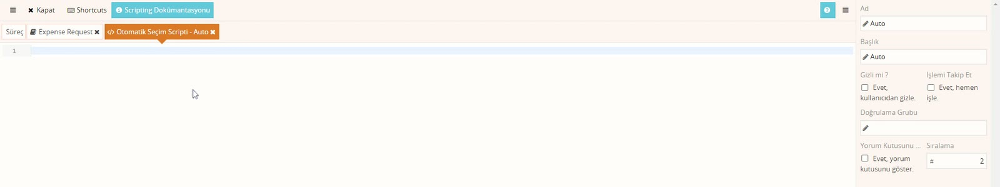

# Koşullu yönlendirme

> **Taslak.** Biçim ve içerik onayı bekliyor.

Akışın form verisine göre farklı yoldan gitmesi sık istenir: toplamı 500 liranın altındaki masraflar yönetici onayına uğramadan muhasebeye gitsin, 500 lira ve üzeri yönetici onayından geçsin. Bunun iki yolu vardır; bu sayfa ikisini karşılaştırır.

## Yöntem 1: rotalara Doğrulama Kuralı

Aksiyondan iki rota çıkarılır ve her birine koşul yazılır.

1. **Submit** aksiyonundan **Yönetici Onayı** görevine bir rota, **Muhasebe** görevine ikinci bir rota çizin.
2. Yöneticiye giden rotaya sağ tıklayın, **Doğrulama Kuralı**'na şunu yazın:

   ```js
   $Xml.Sum('Expenses/Expense/Amount') >= 500
   ```

3. Muhasebeye giden rotaya tersini yazın:

   ```js
   $Xml.Sum('Expenses/Expense/Amount') < 500
   ```

Kuralı doğru dönen rota izlenir, yanlış dönen izlenmez. Kural yazılan rotanın üzerinde şimşek simgesi görünür. Rota kurallarının ayrıntısı: [Akış tasarımı → Rotaya koşul koyma](/akis-tasarimi#rotaya-kosul-koyma-dogrulama-kuralı).

Sakıncaları:

- Şemadaki ok sayısı artar; ok arttıkça akışı okumak zorlaşır.
- Sınır değişirse (500 yerine 250) iki rotayı birden düzeltmeniz gerekir.

## Yöntem 2: Otomatik Seçim Scripti

Rota tektir; her masraf Yönetici Onayı görevine gelir, ama koşul sağlanıyorsa görev **kimseye atanmadan kendiliğinden tamamlanır**.

Her aksiyonun bir **Otomatik Seçim Scripti** vardır (aksiyon kutusundaki ileri-sar simgesi). Script doğru dönerse görev o aksiyonla tamamlanmış sayılır ve akış o aksiyonun rotasından devam eder.



Önerilen kurulum, otomatik geçiş için ayrı bir aksiyon açmaktır:

1. Yönetici Onayı görevine **Auto** adlı bir aksiyon ekleyin ve rotasını **Approve** ile aynı göreve (Muhasebe) bağlayın.
2. Aksiyonun **Otomatik Seçim Scripti**'ne koşulu yazın:

   ```js
   $Xml.Sum('Expenses/Expense/Amount') < 500
   ```

3. Aksiyonun özelliklerinde **Gizli mi ?** → *Evet, kullanıcıdan gizle.* kutusunu işaretleyin. Böylece kullanıcı bu aksiyonu elle alamaz.

Koşulun yönüne dikkat edin: script **otomatik geçilecek** durumu tarif eder. 500 liranın altı onaysız geçecekse koşul "500'den küçük"tür.

Ayrı aksiyon açmak yerine scripti doğrudan **Approve**'a da yazabilirsiniz. O zaman tarihçede otomatik geçişle yöneticinin gerçek onayı aynı aksiyon adıyla görünür; ayrı aksiyon ikisini ayırır.

### Nasıl çalışır

Görev oluşurken sıra şudur:

1. Görevin **İş Öncesi Script**'i çalışır.
2. Aksiyonların Otomatik Seçim Scriptleri, aksiyonların **Sıralama** değerine göre küçükten büyüğe çalışır. Scripti boş olan aksiyon atlanır.
3. Doğru dönen ilk aksiyon seçilir: rol scripti çalışmaz, görev kimseye atanmaz, bildirim gitmez. Görevin **İş Sonrası Script**'i yine çalışır ve akış seçilen aksiyonun rotasından devam eder.
4. Hiçbiri doğru dönmezse görev her zamanki gibi role atanır.

Art arda gelen görevlerin hepsi bu yolla kendiliğinden geçebilir; akış hiç beklemeden birkaç adım ilerler.

**Tarihçede** otomatik geçilen görev listede yer alır; **Atanan** ve **Tamamlayan** sütunları boştur, **Aksiyon** sütununda seçilen aksiyonun adı (örnek: Auto) yazar. Görevi kimsenin değil sistemin tamamladığı buradan anlaşılır.

> **Gizlemeden önce sırayı ayarlayın.** Aksiyon gizli işaretlendiğinde **Sıralama** ve **Doğrulama Grubu** alanları özellik panelinden kalkar.

## Hangisi

| | Rota kuralı | Otomatik Seçim Scripti |
|---|---|---|
| Koşul kaç yerde | Her rotada ayrı | Tek aksiyonda |
| Şema | Aksiyondan birden çok ok çıkar | Tek ok; görev atlanır |
| Atlanan görev tarihçede | Görünmez | Görünür (atanan ve tamamlayan boş) |
| Atlanan görevin scriptleri | Çalışmaz | İş Öncesi ve İş Sonrası Script çalışır |

Bir görevi koşula göre **atlamak** için Otomatik Seçim Scripti, akışı gerçekten **farklı kollara ayırmak** için rota kuralı uygundur. Bu bir kural değil, eğitmenin önerisidir.

---

**Kaynak:** Script Eğitimi – Veysel, 123:30–141:30. Videoda eksik ya da belirsiz kalan noktalar ürün davranışına göre tamamlandı.
