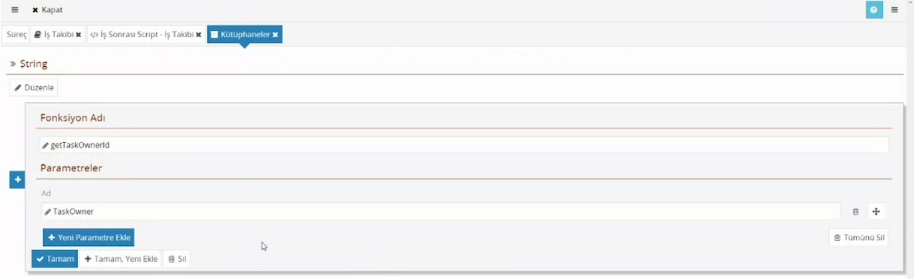
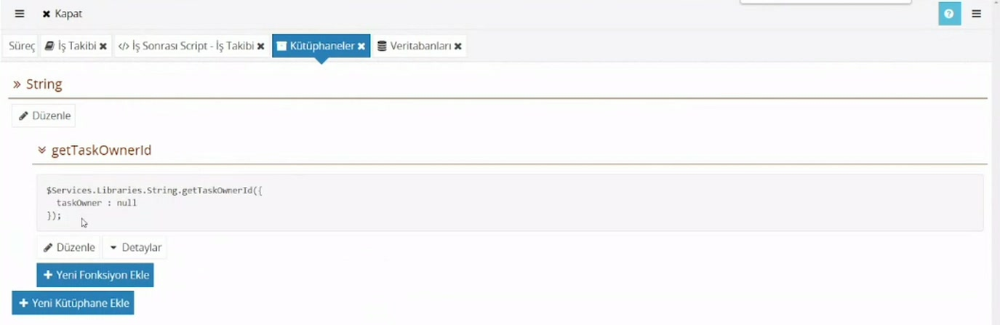

# Script kütüphaneleri

::: v-pre

> **Taslak.** Biçim ve içerik onayı bekliyor.

Aynı script parçasını birden çok yerde kullanacaksanız onu bir kez **kütüphane fonksiyonu** olarak yazıp istediğiniz scriptten çağırabilirsiniz. Bu sayfa kütüphane ve fonksiyon oluşturmayı, fonksiyonu çağırmayı anlatır.

## Kütüphane oluşturma

1. Süreç ekranında **Web Servisleri** başlığının altındaki **Kütüphaneler**'e tıklayın.
2. **Yeni Kütüphane Ekle**'ye basın ve **Kütüphane Adı** verin (örnek: `String`).

Kütüphane, ilgili fonksiyonları bir arada tutan bir addır; içine istediğiniz kadar fonksiyon eklersiniz.

## Fonksiyon ekleme

Kütüphanenin içinde **Yeni Fonksiyon Ekle**'ye basın.



| Alan | Ne yazılır |
|---|---|
| Fonksiyon Adı | Fonksiyonun adı (örnek: `getTaskOwnerId`). |
| Parametreler | Fonksiyonun alacağı değerler. **Yeni Parametre Ekle** ile satır ekleyip her birine **Ad** verin. |

Kütüphane, fonksiyon ve parametre adlarını harfle başlayan, boşluksuz ve Türkçe karakter içermeyen adlar olarak verin; bu adlar script içinde yazılacaktır.

Fonksiyon eklendikten sonra altında iki düğme görünür:

- **Düzenle:** Adı ve parametreleri değiştirir.
- **Detaylar:** Fonksiyonun gövdesini yazacağınız script alanını açar.

## Fonksiyonun gövdesini yazma

Gövde, görev scriptleriyle aynı dilde (JavaScript) yazılır.

- **Parametreler** gövdede başına `$` konarak okunur: parametrenin adı `taskOwner` ise gövdede `$taskOwner` yazarsınız.
- **Sonuç**, gövdenin son satırındaki ifadenin değeridir. Sonucu tutan değişkeni son satıra tek başına yazın (örnek: `result;`).
- Fonksiyon bir görev scriptinden çağrıldığında o scriptin nesnelerini (`$Xml`, `$WorkItem`, `$Database`, `$Membership`) aynen kullanabilir.

## Fonksiyonu çağırma

Fonksiyonun adına tıkladığınızda altında nasıl çağrılacağını gösteren bir kutu açılır. Yanındaki **Kopyala** düğmeleri çağrı satırını panoya alır.



Çağrı her zaman şu biçimdedir:

```js
$Services.Libraries.String.getTaskOwnerId({
    taskOwner : 'Ada Yılmaz'
}).then(function (result) {
    // result: fonksiyonun döndürdüğü değer
});
```

- `String` kütüphanenin, `getTaskOwnerId` fonksiyonun adıdır.
- Değerler sırayla değil, **adlarıyla** tek bir nesne içinde verilir: `{ taskOwner : … }`.
- Sonuç `.then(function (result) { … })` içinde alınır.

> **Eski süreçlerde:** Eski bir sürümde oluşturulmuş süreçlerde çağrı sonucu doğrudan verir; `.then` yazılmaz: `var id = $Services.Libraries.String.getTaskOwnerId({ taskOwner : ad });`. Eğitim videosundaki örnek bu biçimdedir. Kendi sürecinizde hangisinin geçerli olduğunu, fonksiyonun altındaki çağrı kutusunu kopyalayıp sonucu `throw` ile görerek anlayabilirsiniz.

Fonksiyonları İş Öncesi ve İş Sonrası Script'ten, rol scriptlerinden, rotadaki Doğrulama Kuralı'ndan ve form tarafındaki scriptlerden çağırabilirsiniz. Nereden çağrılırsa çağrılsın gövde sunucuda çalışır.

## Örnek: addan kimlik numarası bulma

Tabloya Excel'den yapıştırılan satırlarda görev sahibinin yalnızca adı gelir, numarası (`Id`) boş kalır. Bir kütüphane fonksiyonu adı alıp numarayı döndürür; İş Sonrası Script numarası boş olan satırları dolaşıp fonksiyonu çağırır ve sonucu satıra yazar:

```js
$Xml.SelectAll('Gorevler/Gorev[GorevSahibi/Id = ""]', function () {

    var gorev = this;

    $Services.Libraries.String.getTaskOwnerId({
        taskOwner : gorev.Evaluate('GorevSahibi/Ad')
    }).then(function (taskOwnerId) {
        gorev.SetValue('GorevSahibi/Id', taskOwnerId);
    });
});
```

`$Xml.SelectAll` için: [İş Öncesi ve İş Sonrası Script → Tekrarlayan satırları dolaşma](/is-oncesi-ve-is-sonrasi-script#tekrarlayan-satırları-dolasma).

Eğitimde fonksiyonun içi, kullanıcı listesini veri tabanından çekip yazılan adı en çok benzeyen kayıtla eşleştirir (harf büyüklüğü ya da küçük yazım farkı olsa da bulur; benzerlik yüzde 80'in altındaysa boş döner). Eşleştirme algoritması CodEase'e ait değildir, sayfaya alınmadı.

## Veri tabanından satır okuma

Fonksiyon içinde (ya da herhangi bir görev scriptinde) bir tablodan satır okumak için `$Database.Get` kullanılır:

```js
var users = [];

$Database.Get({ /* sorgu */ }).Each(function () {
    users.push({
        Id : this.Id,
        DisplayName : this.DisplayName
    });
});
```

- `.Each(function () { … })` dönen her satır için çalışır; `this` o satırdır.
- Sütunlar adlarıyla okunur: `this.Id`, `this.DisplayName`.

Sorguyu elle yazmanız gerekmez. Script alanında `$Database.Get(` yazdığınızda çıkan ipucunda **Query** sözcüğüne tıklayın; **Veritabanı Sorgusu** penceresi açılır. **Hedef Şema** ve **Hedef Tablo**'yu seçin, **Alanlar**'a istediğiniz sütunları, **Kriter**'e koşulları ekleyin; onayladığınızda sorgu parantezin içine yazılır. Var olan bir sorgunun içindeyken aynı yere tıklarsanız pencere o sorguyla açılır.

Kullanacağınız şema süreçte tanımlı olmalıdır: süreç ekranında **Veritabanları**'na girin ve **Import** ile şemayı sürece alın.

Tabloya yazma ve diğer işlevler: [Scriptte veri tabanı](/scriptte-veri-tabani).

:::

---

**Kaynak:** CodEase Eğitim 8 – Fatih, 16:30–43:00. Videoda eksik ya da belirsiz kalan noktalar ürün davranışına göre tamamlandı.
