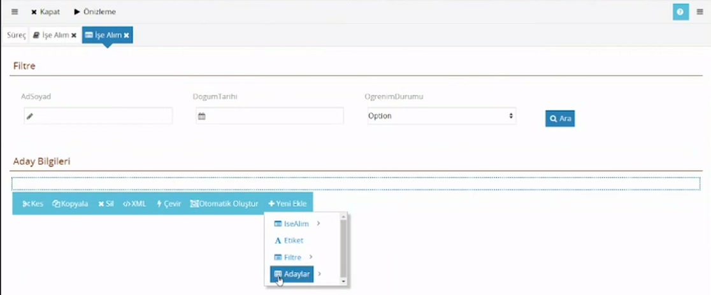
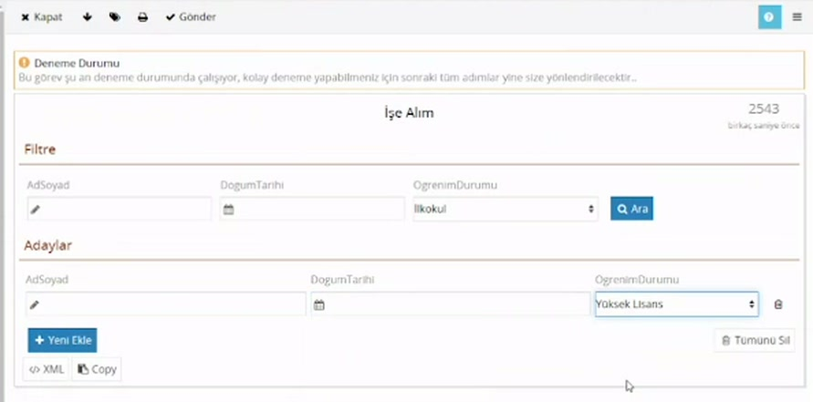
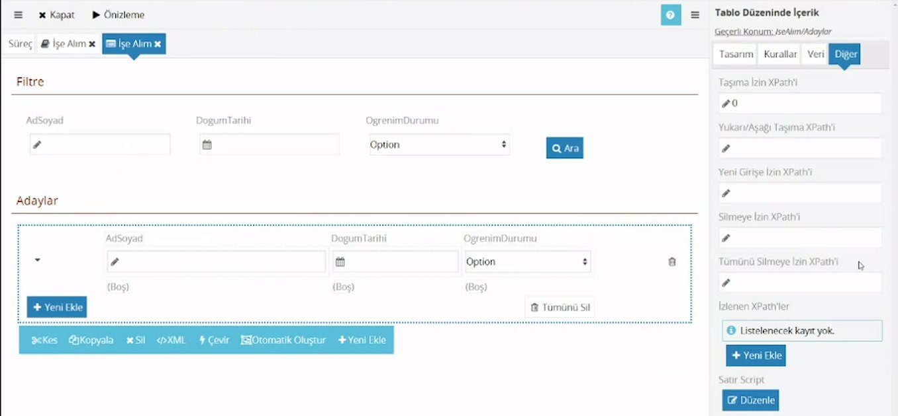

# Tablo düzeninde içerik

> **Taslak.** Biçim ve içerik onayı bekliyor.

Aynı bilgiden birden çok girilecekse (bir işe alımda birden çok aday, bir siparişte birden çok kalem) formda **Tablo Düzeninde İçerik** kullanılır. Kullanıcı satır ekler, her satırda aynı alanları doldurur.

## 1. Veri modelini hazırlayın

Tablo, tekrarlayan bir elemana bağlanır: `Adaylar` bölümünün altında liste öğesi olarak işaretlenmiş `Aday`, onun altında `AdSoyad`, `DogumTarihi`, `OgrenimDurumu`. Kurulumu: [Veri modeli → Tekrarlayan elemanlar](/veri-modeli#tekrarlayan-elemanlar).

## 2. Tabloyu forma ekleyin

Form tasarımcısında **Yeni Ekle**'ye bastığınızda tekrarlayan elemanı içeren bölüm (`Adaylar`) menüde farklı bir simgeyle görünür. Tıklayınca **Tablo Düzeninde İçerik** eklenir.



## 3. Sütunları oluşturun

1. Tabloya tıklayın ve **Yeni Sütun Ekle**'ye basın. Kaç alan gösterecekseniz o kadar sütun ekleyin.
2. Her sütuna tıklayıp **Yeni Ekle** ile `Aday`'ın altındaki alanlardan birini seçin.

Tablonun üstündeki **Otomatik Oluştur** bütün alanlar için sütunları tek seferde üretir.

Sütunu seçince **Tasarım** sekmesinde şunlar bulunur:

| Ayar | Ne işe yarar |
|---|---|
| Etiket | Sütun başlığı. Veri modelindeki addan gelir; kullanıcının anlayacağı biçimde düzeltin. |
| Genişlik | Sütunun yüzde olarak genişliği (örnek: 34, 33, 33). |
| Hizalama | **Sol**, **Orta**, **Sağ**. |
| Altbilgi | Sütunun altında gösterilecek yazı. Toplam gibi hesaplanan bir değer de olabilir: [Etikette hesaplama](/etikette-hesaplama). |

Genişliklerin toplamı 100 olmak zorunda değildir. Daha azını verirseniz tablo satırın tamamını kaplamaz; 100'ü aşarsa tablo bulunduğu alandan geniş olur.

## Kullanıcı tabloyu nasıl kullanır



- **Yeni Ekle** tablonun altına boş bir satır ekler. (`Alt` + `N` de aynı işi yapar.)
- Satırın sağındaki çöp kutusu o satırı siler.
- **Tümünü Sil** bütün satırları siler; tabloda satır varken görünür.

Silme hemen kesinleşmez:

- Form açıldığında zaten bulunan bir satırı sildiğinizde satır soluklaşır ve yanında **Geri Al** düğmesi çıkar. Form kaydedilene (bir aksiyon alınana) kadar satırı geri getirebilirsiniz.
- O oturumda yeni eklediğiniz bir satırı silerseniz hemen kalkar, geri alınamaz.
- **Tümünü Sil** için de aynısı geçerlidir; toplu bir geri alma yoktur, satırlar tek tek geri alınır.

Düğmenin yazısını tabloyu seçip **Tasarım** → **Yeni Ekleme Etiketi** ile değiştirebilirsiniz (örnek: "Yeni Aday Ekle"). Tablo boşken "Listelenecek kayıt yok." yazar; bu yazı da **Tasarım** sekmesinden değiştirilir.

## Ekleme ve silmeyi sınırlama

Tabloyu seçin ve sağ panelde **Diğer** sekmesine geçin.



| Ayar | Neyi denetler |
|---|---|
| Yeni Girişe İzin XPath'i | **Yeni Ekle** düğmesi |
| Silmeye İzin XPath'i | Satırlardaki silme düğmesi |
| Tümünü Silmeye İzin XPath'i | **Tümünü Sil** düğmesi |
| Taşıma İzin XPath'i | Satırı başka yere taşıma |
| Yukarı/Aşağı Taşıma XPath'i | Satırı yukarı ve aşağı taşıma |

Her alana şunlardan biri yazılır:

- **Boş** ya da `1`: her zaman izinli.
- `0`: her zaman kapalı; düğme görünmez.
- **Bir XPath ifadesi:** sonucu doğruysa izinli. Ekleme ve tümünü silme için tablonun bağlı olduğu bölüme, satır silme için o satıra göre değerlendirilir.

> **Öneri:** **Tümünü Silmeye İzin XPath'i** alanına `0` yazın. Kullanıcı on aday girdikten sonra yanlışlıkla **Tümünü Sil**'e basarsa yeni eklediği satırların hepsi geri alınamadan gider.

Tabloda en çok kaç satır olabileceğini sınırlayan bir ayar yoktur.

## Sütunların sırasını değiştirme

Yeni sütun hep sona eklenir ve sütunlar sürüklenerek taşınamaz. Sırayı değiştirmek için tabloyu seçip araç çubuğundaki **XML**'e basın; açılan metinde her sütun bir `Column` bölümüdür. Taşımak istediğiniz sütunun bölümünü başından sonuna kesip istediğiniz sütunun önüne ya da arkasına yapıştırın ve **Tamam**'a basın.

## Excel'den içeri alma ve dışarı aktarma

Kullanıcının satırları tek tek girmek yerine Excel'den yapıştırabilmesini ya da tabloyu Excel'e alabilmesini sağlayabilirsiniz.

**Tasarımda:** Tabloyu seçin, **Veri** sekmesinde **Excel İçeri/Dışarı Alma** bölümüne gelin.

1. **İçeri Almaya İzin Ver** ve/veya **Dışarı Almaya İzin Ver** kutularını işaretleyin.
2. **Sütun Ekle** ile Excel'deki her sütun için bir satır ekleyin: **Başlık**, **XPath** (satıra göre; örnek: `Tarih`, `Musteri/Ad`) ve **Tip** (**Metin**, **Tarih**, **Tarih ve Saat**, **Numara**).

En az bir sütun tanımlamazsanız düğmeler formda görünmez.

**Formda:** Tablonun altında **İçeri Al** ve **Dışarı Aktar** düğmeleri çıkar.

- **İçeri Al** bir yapıştırma penceresi açar; dosya yüklenmez. Kullanıcı Excel'de satırları kopyalar ve kutuya yapıştırır. Penceredeki **İlk satırda başlıklar var.** ve **Var olan kayıtları sil.** kutuları ile sayı ve tarih biçimi için **Dil** seçimi vardır; **Örnek dosya formatını indir** bağlantısı doğru sütun sırasıyla boş bir Excel verir.
- Sütunlar **sırayla** eşleşir: yapıştırılan birinci sütun tanımdaki birinci sütuna yazılır. Başlık adlarına bakılmaz; tasarımdaki sütun sırası Excel'deki sırayla aynı olmalıdır.
- **Dışarı Aktar** tablodaki satırları, başlıkları tanımdaki **Başlık**'lardan oluşan bir Excel dosyası olarak indirir.

> **Seçim alanlarında dikkat:** Excel'den yalnızca seçeneğin yazısı gelir (`Musteri/Ad`), değeri (`Musteri/Id`) boş kalır. Açılır liste yazıyı kendi seçenekleri arasında bulursa değeri kendisi doldurur; bulamazsa alan boş ya da yanlış seçenekle görünür. Yazım farkı olabilecek alanlarda bileşeni **Çevir** ile **Seçim Listesi**'ne dönüştürüp **Kurallar** → **Yeni Eklemeye İzin Ver**'i işaretleyin (yapıştırılan yazı korunur) ve eksik değerleri İş Sonrası Script'te tamamlayın: [Script kütüphaneleri → Örnek](/script-kutuphaneleri#ornek-addan-kimlik-numarası-bulma).

## Satırın altında ayrıntı alanı

Her satırın başındaki küçük oka basıldığında satırın altında bir alan açılır. Tasarımcıda oka basıp açılan alana bileşen bırakırsanız, kullanıcı da satırı aynı okla genişletip o bileşenleri görür. Sütunlara sığmayan alanlar ya da satıra bağlı **ikinci bir tablo** (grubun altında tipler gibi) buraya konur. Alan boşsa kullanıcıya ok gösterilmez.

İçteki tablo, satırın altındaki çoklanan elemana bağlanır; yolu satıra göre yazılır. Baştan sona bir örnek: [Örnek: listeleri yöneten ayar ekranı](/ayar-ekrani#form-grubun-altında-tipler).

## Yeni satıra başlangıç değeri: Satır Script

Tablonun **Diğer** sekmesindeki **Satır Script**, tabloya yeni bir satır eklendiğinde (**Yeni Ekle**, yapıştırma, içeri alma) çalışır. Yeni satır `$NewChild` adıyla gelir:

```js
$NewChild.SetValue('Durum', 'Yeni');
```

Yol satıra göre yazılır. Veritabanı Sorgusu'nun getirdiği satırlarda bu script çalışmaz.

Tablonun **Veri** sekmesindeki **Satır No XPath'i**'ne bir alan yazarsanız (örnek: `Id`), eklenen her satıra o alanda kendiliğinden benzersiz bir kimlik verilir.

## Tabloyu zorunlu yapma

Tablonun **Kurallar** sekmesinde de **Zorunluluk Grup Adı** vardır; tabloda **en az bir satır** bulunmasını zorunlu kılar. Satırların içindeki alanların dolu olması için o alanlara ayrıca zorunluluk verin: [Zorunlu alanlar](/zorunlu-alanlar).

## Tablodaki veriyi kullanma

Tablonun verisine kurallarda ve scriptlerde `Adaylar/Aday` yoluyla ulaşılır. Örneğin kaç aday girildiğini saymak için `$Xml.Count('Adaylar/Aday')`, belirli bir koşula uyanları saymak için `$Xml.Count('Adaylar/Aday[OgrenimDurumu/Id = "1"]')` yazılır. Kullanımı: [Akış tasarımı → Rotaya koşul koyma](/akis-tasarimi#rotaya-kosul-koyma-dogrulama-kuralı).

Tek kayıtlı bir veri modelini sonradan tabloya çevirirseniz, eski yolları kullanan veri tabanı sorgularını ve scriptleri de yeni yola (`Adaylar/Aday`) göre güncelleyin.

## Aynı veriyi gösteren başka bileşenler

Tekrarlayan bir eleman şu bileşenlerle de gösterilebilir: **Tekrar Eden İçerik**, **Veri Tablosu**, **Takvim**, **Etiket Listesi**. Eğitim videolarında henüz anlatılmadılar.

---

**Kaynak:** CodEase Eğitim 4 – Fatih, 02:30–15:30 ve 47:30–50:20; CodEase Eğitim 8 – Fatih, 00:00–09:00; Veritabanı Eğitimi – Veysel, 81:30–82:30; CodEase Eğitim – Atılay, Veri Tabanı, 42:30–47:30 ve 57:30–62:30. Videoda eksik ya da belirsiz kalan noktalar ürün davranışına göre tamamlandı.
