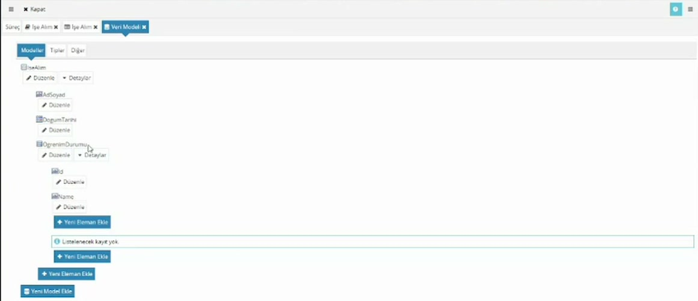
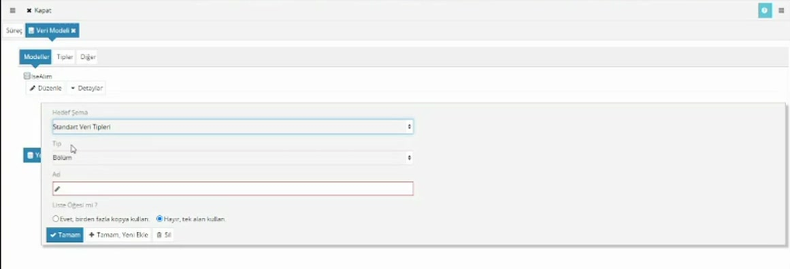
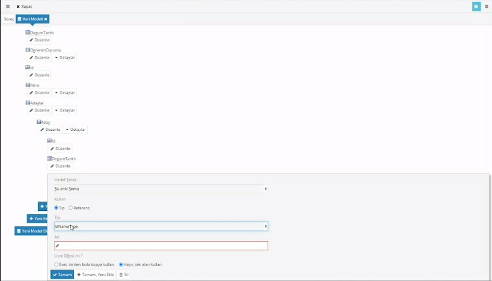
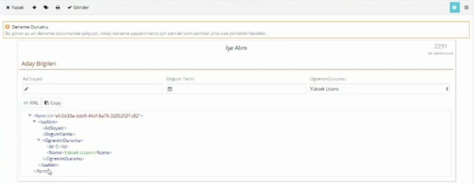

# Veri modeli

> **Taslak.** Biçim ve içerik onayı bekliyor.

Veri modeli, sürecin tutacağı bilgilerin listesidir: aday adı, doğum tarihi, öğrenim durumu gibi. Süreç geliştirirken ilk yapılan iştir, çünkü **forma yalnızca veri modelinde bulunan alanları ekleyebilirsiniz.** Kullanıcının dolduracağı her alan önce burada tanımlanır.

Veri modeli bir ağaçtır: en üstte bir kök (model), altında elemanlar, bölüm tipindeki elemanların altında yine elemanlar.

## Model oluşturma

1. Süreci **Düzenle** ile açın. Süreç ekranında **Diğer** başlığının altındaki **Veri Modeli**'ne tıklayın.
2. **Yeni Model Ekle**'ye basın, modele bir **Ad** verin (örnek: `IseAlim`) ve **Tamam** deyin.

Bu ad modelin köküdür. Havuz oluştururken **Veri Kökü** olarak bunu seçersiniz.

Hiç model yokken ilk havuzu oluşturursanız, havuzun adından bir kök model kendiliğinden oluşur.

## Ad kuralları

Model ve eleman adlarında:

- Yalnızca İngilizce harfler, rakamlar, alt çizgi (`_`), nokta ve tire kullanılır.
- Boşluk ve Türkçe harf (ç, ğ, ı, ö, ş, ü, İ) kullanılmaz.
- Ad rakamla, noktalama işaretiyle ya da `xml` ile başlamaz.

`AdSoyad`, `DogumTarihi`, `OgrenimDurumu` uygun adlardır. Kurala uymayan adda alan kızarır ve şu uyarı çıkar: "Eleman isimleri boşluk içeremez ve numara veya noktalama karakterleri ile başlayamaz." Uyarı Türkçe harften söz etmez ama Türkçe harf de aynı hatayı verir.

Bu adlar kullanıcıya gösterilmez; formda görünen başlığı ayrıca **Etiket** olarak verirsiniz ([Form tasarımı](/form-tasarimi)).

## Eleman ekleme

Modelin altındaki **Detaylar**'a, sonra **Yeni Eleman Ekle**'ye tıklayın.

| Alan | Ne yazılır |
|---|---|
| Hedef Şema | Hazır tipler için **Standart Veri Tipleri**. Kendi tanımladığınız bir tipi kullanacaksanız **Şu anki Şema** ([Tipler](#tipler-aynı-yapıyı-yeniden-kullanma)). |
| Tip | Elemanın tutacağı verinin türü (aşağıdaki tablo). |
| Ad | Elemanın adı. |
| Varsayılan Değer | Bazı tiplerde görünür; alanın baştan dolu gelmesini sağlar. |
| Liste Öğesi mi ? | Bu elemandan birden çok olacaksa **Evet, birden fazla kopya kullan.** ([Tekrarlayan elemanlar](#tekrarlayan-elemanlar)). |

**Tamam** pencereyi kapatır. **Tamam, Yeni Ekle** elemanı ekler ve pencereyi bir sonraki eleman için yeniden açar; art arda alan eklerken bunu kullanın.

### Tipler

| Tip | Ne tutar |
|---|---|
| Bölüm | Kendisi değer tutmaz; altına başka elemanlar eklenir. |
| Metin | Yazı. |
| Numara | Sayı. |
| Tarih Saat | Tarih ve saat birlikte. |
| Tarih | Yalnızca tarih. |
| Saat | Yalnızca saat. |
| İkili Değer | Evet / hayır. |

Tip, alanın formda nasıl görüneceğini de belirler: **Metin** tipindeki eleman forma metin kutusu olarak, **Tarih** tipindeki eleman tarih seçici olarak eklenir. Doğum tarihi gibi saati gerekmeyen bir bilgi için **Tarih Saat** yerine **Tarih** seçin.

### Varsayılan değer

- **Tarih** ve **Tarih Saat:** **Günün Tarihi** seçilirse alan bugünün tarihiyle gelir.
- **Metin:** Süreci başlatan kişinin bilgileriyle doldurulabilir: **Başlatan Kişi Kimliği**, **Başlatan Kişi Ad**, **Başlatan Kişi Sicil No**, **Başlatan Kişi Departman Kimliği**, **Başlatan Kişi Departman Adı**, **Başlatan Kişi Pozisyon Kimliği**, **Başlatan Kişi Pozisyon Adı** ya da **Akış Numarası**.
- **Numara** ve **İkili Değer:** Değeri elle yazarsınız.

## Seçim listesi için eleman

Açılır liste ya da radyo düğmeyle seçilecek bir bilgi (öğrenim durumu, şehir) için tek bir **Metin** elemanı yetmez. Kullanıcının gördüğü yazı ile arkada saklanan değer ayrı tutulur:

- Elemanı **Bölüm** tipinde ekleyin (örnek: `OgrenimDurumu`).
- Altına **Metin** tipinde iki eleman ekleyin: `Id` ve `Name`.

`Id` seçeneğin değerini (örnek: `4`), `Name` kullanıcının gördüğü yazıyı (örnek: `Lisans`) tutar. Kurallarda ve scriptlerde karşılaştırmayı `Id` üzerinden yaparsınız; yazı sonradan değişse de kural bozulmaz.

Belirleyici olan adlar değil **sıradır**: bölümün altında en az iki eleman bulunmalı, ilk **Metin** (ya da **Numara**) elemanı değeri, ondan sonraki **Metin** elemanı yazıyı tutar. Bu yapıdaki bir bölüm forma eklenirken liste bileşeni olarak önerilir. `Id` ve `Name` adlarını kullanmak alışkanlıktır; hep aynı adları kullanmak scriptleri okunur kılar.

Listenin seçeneklerini formda tanımlarsınız: [Açılır liste](/acilir-liste).

## Tekrarlayan elemanlar

Bir bilgiden birden çok girilecekse (bir işe alımda birden çok aday) elemanı liste öğesi yaparsınız.

1. Kökün altına **Bölüm** tipinde bir eleman ekleyin: `Adaylar`.
2. Onun altına yine **Bölüm** tipinde `Aday` ekleyin ve **Liste Öğesi mi ?** sorusunda **Evet, birden fazla kopya kullan.**'ı seçin.
3. **En az tekrar** alanına en az kaç tane olacağını yazın.
4. `Aday`'ın altına her adayda tutulacak elemanları ekleyin: `AdSoyad`, `DogumTarihi`, `OgrenimDurumu`.

En çok kaç tane olabileceğini sınırlayan bir alan yoktur.

Formda tekrarlayan eleman satır satır gösterilir: [Tablo düzeninde içerik](/tablo-duzeninde-icerik).

## Tipler: aynı yapıyı yeniden kullanma

`Id` + `Name` gibi bir yapıyı birçok yerde kullanacaksanız her seferinde elle kurmak yerine bir kez tip olarak tanımlayın.

1. Veri modelinin üstündeki **Tipler** sekmesine geçin, **Yeni Tip Ekle** ile bir tip oluşturun (örnek: `IdNameType`) ve altına `Id` ile `Name` elemanlarını ekleyin.
2. **Modeller** sekmesine dönün. Eleman eklerken **Hedef Şema**'yı **Şu anki Şema** yapın, **Kullan** satırında **Tip** seçili kalsın, **Tip** listesinden `IdNameType`'ı seçin ve elemana adını verin.

Eleman, tipin içindeki `Id` ve `Name` ile birlikte oluşur.

## Modeli sonradan değiştirme

- Bir elemanın tipini **Düzenle** ile değiştirebilirsiniz. **Bölüm** tipindeki bir elemanı başka bir tipe çevirirseniz altındaki elemanlar silinir.
- Forma eklenmiş bir alanın veri modelindeki elemanını siler ya da yerini değiştirirseniz, o alan form tasarımcısında kırmızı görünür. Alanı formdan kaldırıp yeni yerinden yeniden ekleyin.
- Veri modelindeki yol değiştiğinde o yolu kullanan veri tabanı sorgularını, scriptleri ve kuralları da güncellemeniz gerekir.

### Kullanımdaki süreçte modele alan ekleme

Çalışan akışlar, başlatıldıkları versiyonun **güncel** formunu kullanır; verileri ise başlatıldıkları andaki modele göre oluşmuştur. Kullanımdaki bir versiyonun modeline alan ekleyip forma koyarsanız, daha önce başlamış akışlarda o alan veride bulunmaz: bileşen kırmızı görünür, üzerine gelindiğinde "This field has invalid xpath …" yazar ve alan kullanılamaz.

Bu yüzden **kullanımdaki sürecin veri modeline alan eklemeyi yeni bir versiyonda yapın**: [Dizinler ve süreçler → Kullanımdaki süreci değiştirme](/dizinler-ve-surecler#kullanımdaki-sureci-degistirme-yeni-versiyon). Eski akışlar eski versiyonla tamamlanır, yeniler yeni modelle başlar.

Denerken aynı durumla karşılaşırsanız (modeli değiştirdiniz, açık duran deneme görevinde alan kırmızı) görevi kapatıp süreci yeniden başlatın.

## Veriyi görme

Deneme Durumu'ndaki bir süreçte formun altında **XML** ve **Copy** düğmeleri bulunur. **XML** formdaki verinin o anki halini veri modelinin ağacıyla gösterir; **Copy** aynı içeriği kopyalamanız için bir kutuda açar. Bir alanın nereye, hangi değerle yazıldığını buradan denetlersiniz. Aynı düğmeler form tasarımcısındaki **Önizleme**'de de vardır.

---

**Kaynak:** CodEase Eğitim 1 – Fatih, 17:30–26:30, 56:00–57:30, 62:00–65:00; CodEase Eğitim 4 – Fatih, 02:30–09:20; Veritabanı Eğitimi – Veysel, 88:30–90:30. Videoda eksik ya da belirsiz kalan noktalar ürün davranışına göre tamamlandı.
