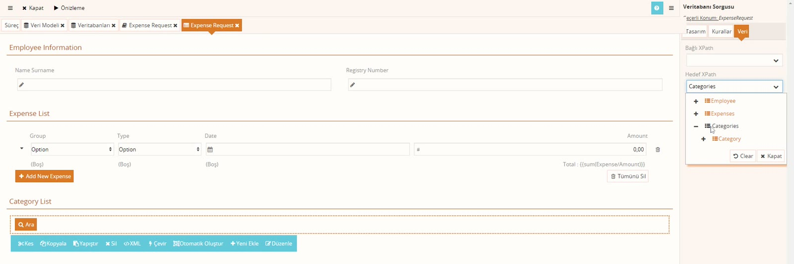
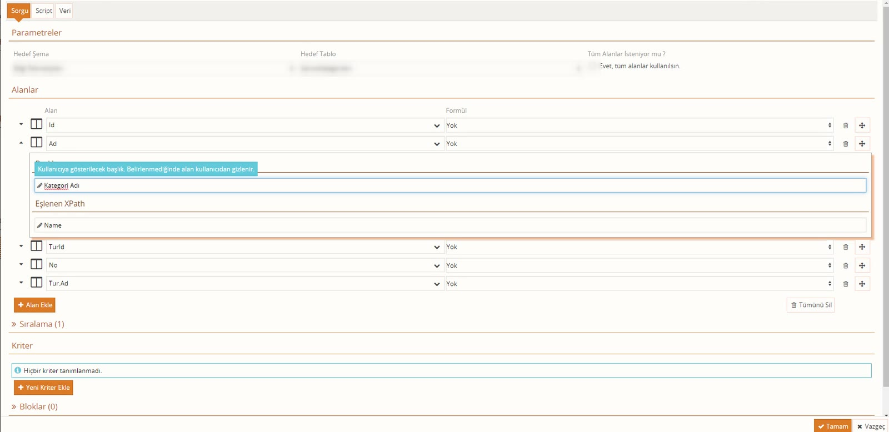
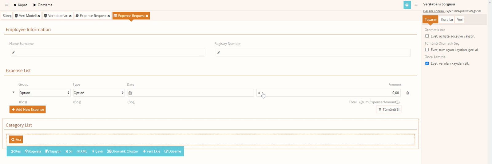

# Veritabanı Sorgusu bileşeni

> **Taslak.** Biçim ve içerik onayı bekliyor.

**Veritabanı Sorgusu**, bir tablodan kayıt çekip formun verisine yazan bileşendir. Açılır listenin veri kaynağına benzer, ama seçenek doldurmaz: çektiği her kaydı veri modelinde bir satır olarak ekler. Bu sayfa bileşeni kurmayı, sütunları alanlarla eşleştirmeyi ve sorgunun ne zaman çalıştığını anlatır.

Bileşenin kendi görüntüsü yoktur (en fazla bir **Ara** düğmesi). Çektiği veriyi göstermek için aynı elemana bağlı bir tablo ya da alanlar koymanız gerekir.

## Önce veri modeli

Kayıtların yazılacağı yer veri modelinde tekrarlayan bir eleman olmalıdır. Örnek:

```
Categories
└─ Category        (liste öğesi; En az tekrar: 0)
   ├─ Id
   ├─ Name
   ├─ Number
   └─ Type
      ├─ Value
      └─ Name
```

Tablodan gelen her kayıt bir `Category` olur; kaydın sütunları `Category`'nin altındaki alanlara yazılır.

## Bileşeni ekleme ve sorguyu yazma

1. Formda **Yeni Ekle** → kökün yanındaki ok → **Veritabanı Sorgusu**.
2. Bileşenin üzerindeki **Düzenle**'ye basın. Sorgu penceresi açılır.
3. **Hedef Şema** ve **Hedef Tablo**'yu seçin.
4. **Alan Ekle** ile çekilecek sütunları ekleyin. İlişkili tablodaki bir sütunu noktayla alabilirsiniz (örnek: `Tur.Ad`).
5. Gerekirse **Sıralama** ve **Kriter** ekleyin, **Tamam**'a basın.

Kullanacağınız şema süreçte tanımlı olmalıdır (süreç ekranı → **Veritabanları**).

## Kayıtların nereye yazılacağı

Bileşeni seçin, **Veri** sekmesine geçin.



| Alan | Ne yazılır | Örnek |
|---|---|---|
| Hedef XPath | Kayıtların **içine** yazılacağı eleman. | `Categories` |
| Öğe XPath'i | Her kayıt için çoğaltılacak eleman. | `Category` |

Hedef XPath, bileşenin içinde durduğu yere göre yazılır. Bileşeni zaten `Categories`'e bağlı bir bölümün içine koyduysanız Hedef XPath'i boş bırakıp yalnızca Öğe XPath'i verebilirsiniz.

## Sütunları alanlarla eşleştirme

Sorgu penceresinde her alanın solundaki oka basınca iki kutu açılır:



| Kutu | Ne işe yarar |
|---|---|
| Eşlenen XPath | Sütunun yazılacağı alan, Öğe XPath'indeki elemana göre (örnek: `Name`, `Type/Value`). |
| Başlık | Arama sonuçları penceresinde sütunun başlığı. Boş bırakılan sütun pencerede görünmez. |

- **Eşlenen XPath boşsa** sütun, kendi adıyla aynı adı taşıyan alana yazılır. Sütunun adı `Id`, alanın adı da `Id` ise bir şey yazmanız gerekmez.
- **Eşleşen alan bulunamazsa hata çıkmaz**, o sütun atlanır. Bir alan boş geliyorsa önce yolu denetleyin: `Type/Name` yerine `TypeName` yazmak en sık yapılan hatadır. Formun altındaki **XML** düğmesi verinin gerçekte nereye yazıldığını gösterir.

## Sorgu ne zaman çalışır

Bileşenin **Tasarım** sekmesinde üç ayar vardır:



| Ayar | İşaretliyse |
|---|---|
| Otomatik Ara — *Evet, açılışta sorguyu çalıştır.* | Form açılırken sorgu kendiliğinden çalışır; **Ara** düğmesi görünmez. |
| Tümünü Otomatik Seç — *Evet, tüm uyan kayıtları içeri al.* | **Ara**'ya basınca bulunan bütün kayıtlar doğrudan forma yazılır. |
| Önce Temizle — *Evet, varolan kayıtları sil.* | Yeni kayıtlar yazılmadan önce eski satırlar silinir. |

Üç tipik kullanım:

- **Kullanıcı seçsin:** İkisi de işaretsiz. Kullanıcı **Ara**'ya basar, **Arama Sonuçları** penceresi açılır, istediği kayıtları işaretleyip **Tamam**'a basar. Pencerede yalnızca **Başlık** verdiğiniz sütunlar görünür; hiçbirine başlık vermezseniz pencere boş sütunlu gelir.
- **Düğmeyle hepsi gelsin:** Yalnızca **Tümünü Otomatik Seç** işaretli.
- **Form açılınca hepsi gelsin:** **Otomatik Ara** işaretli.

### Otomatik Ara her açılışta çalışmaz

**Otomatik Ara** yalnızca hedefte henüz kayıt yokken çalışır. Bu bir korumadır: ilk görevde gelen kayıtların bir kısmını kullanıcı silmiş ya da değiştirmiş olabilir; form sonraki görevde açıldığında sorgu yeniden çalışsaydı bu değişiklikler kaybolurdu.

Sorgu şu iki durumda çalışır:

- Hedefte Öğe XPath'ine uyan hiç eleman yoksa.
- Var olan elemanların hepsini sistem kendisi eklemişse. Veri modelinde **En az tekrar** 1 ise form boş bir satırla açılır; bu satır sistemin eklediği satırdır, sorgu onu silip kayıtları yazar.

Kullanıcının ya da bir scriptin eklediği tek bir satır bile varsa sorgu çalışmaz. **Ara** düğmesi bu koşula bakmaz; her basışta çalışır.

Kriterinde formdaki bir alanı kullanan sorgu (çift süslü parantezle), o alan değiştiğinde yeniden çalışır.

## Aynı işi scriptle yapma

Tablodan okuyup veri modeline yazmayı İş Öncesi Script'te `$Database.ExportToXml` ile de yapabilirsiniz: [Scriptte veri tabanı](/scriptte-veri-tabani).

---

**Kaynak:** Script Eğitimi – Veysel, 00:00–32:00. Videoda eksik ya da belirsiz kalan noktalar ürün davranışına göre tamamlandı.
