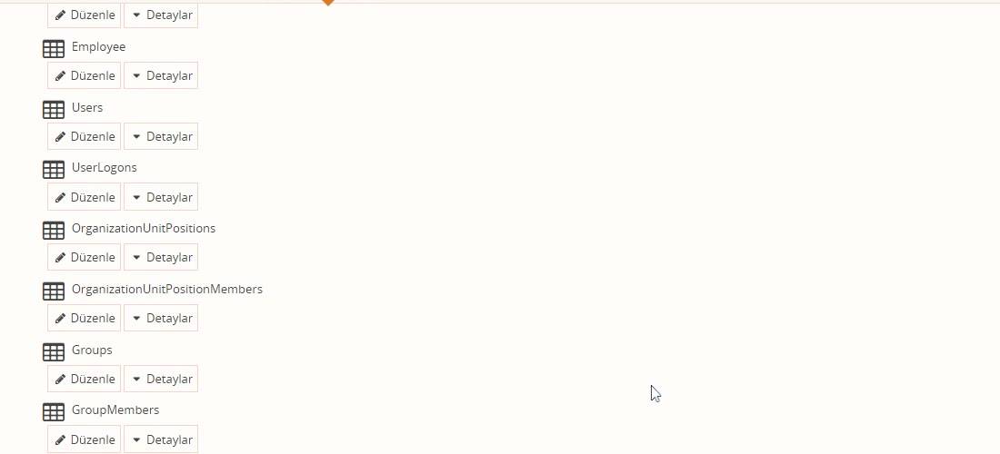
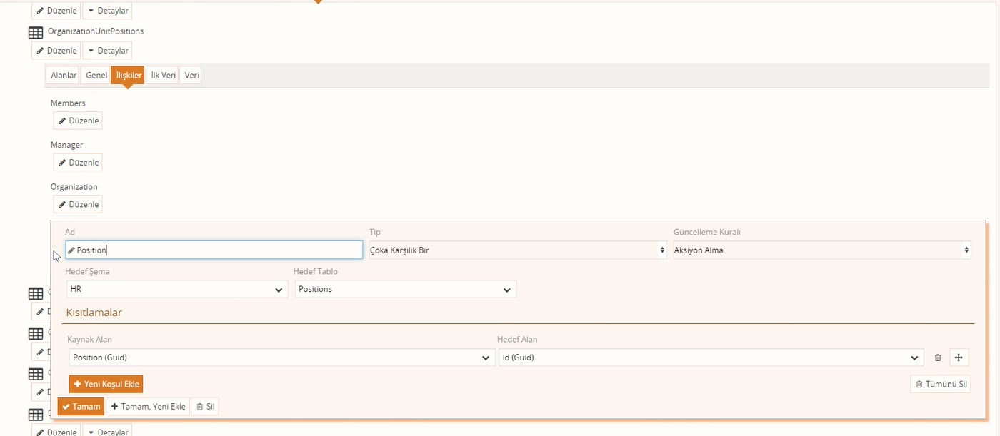
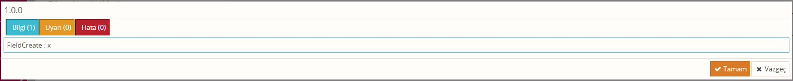

# Veritabanları: şema, tablo ve ilişki

> **Taslak.** Biçim ve içerik onayı bekliyor.

Süreçte bir tablodan veri okumak ya da tabloya yazmak için önce o tablonun **şeması** sürece alınır. Aynı ekranda yeni tablo, alan ve ilişki de tanımlanır. Bu sayfa şemayı sürece almayı, tablo tanımlamayı ve yapılan değişikliğin gerçek veri tabanına ne zaman, nasıl yansıdığını anlatır.

## Şema nedir

Şema, tabloları bir arada tutan addır; veri modelindeki bölümün tablolar için karşılığı gibi düşünülebilir. Sürece tablo tek tek değil, şema olarak alınır: şemayı aldığınızda içindeki bütün tablolar gelir.

Sistemle birlikte **HR** şeması gelir; kullanıcılar, departmanlar, pozisyonlar ve gruplar bu şemanın tablolarında tutulur. Bu tablolara kendi alanlarınızı ve ilişkilerinizi ekleyebilirsiniz.

## Şemayı sürece alma

1. Süreç ekranında **Diğer** başlığının altındaki **Veritabanları**'na tıklayın.
2. **Import**'a basın, listeden şemayı işaretleyin ve **Tamam**'a basın.

Şemayı sürece almak, tanımının bir **kopyasını** sürecin içine koyar. Sorgu pencerelerindeki **Hedef Şema** ve **Hedef Tablo** listeleri yalnızca sürece alınmış şemaları gösterir.

Yeni bir şema açmak için **Yeni Şema Ekle**'ye basıp **Ad** ve **Ön Ek** verin; içine **Yeni Tablo Ekle** ile tablo ekleyin.

## Tablo tanımlama

Tablo satırındaki **Detaylar** beş sekme açar:

| Sekme | Ne var |
|---|---|
| Alanlar | Tablonun sütunları: **Ad**, **Tip**, **Boyut**. **Yeni Alan Ekle** ile eklenir. |
| Genel | **Birincil Anahtar (Primary Key)**: kayıtları ayırt eden alan. |
| İlişkiler | Tablonun başka tablolarla bağları. |
| İlk Veri | Tablo ilk kez oluşturulurken içine konacak kayıtlar. |
| Veri | Tablodaki gerçek kayıtlar: arama, ekleme, düzeltme, silme. |

### Alan tipleri

| Tip | Ne tutar |
|---|---|
| Limitli Metin | **Boyut** kadar karakter. Boyut vermek zorunludur. |
| Limitsiz Metin | Uzun metin |
| Tam Sayı | Kesirsiz sayı |
| Noktalı Sayı | Kesirli sayı |
| Para | Tutar |
| Evet/Hayır | İki değerli |
| Tarih/Saat | Tarih ve saat |
| Tekil Tanımlayıcı | Sistemin ürettiği benzersiz kimlik |
| Xml, Dosya | XML içerik, dosya |

Yeni tabloya kendiliğinden alan eklenmez. Her tabloya **Tekil Tanımlayıcı** tipinde bir `Id` alanı ekleyip **Genel** sekmesinde birincil anahtar olarak seçin: kayıt eklerken `Id` boşsa sistem kendisi üretir. Birincil anahtarı olmayan tabloya kayıt yazılamaz.

Alan ve tablo adlarını harfle başlayan, boşluksuz, Türkçe karakter ve nokta içermeyen adlar olarak verin.

### Veri sekmesi

**Filtre** kutusuna yazdığınız metni içeren kayıtlar listelenir (en çok 100 kayıt); `*` hepsini getirir. **Yeni Kayıt Ekle** ile satır ekleyebilir, listelenen satırları düzeltebilir ya da silebilirsiniz.

## İlişkiler

İlişki, bir tablodaki alanı başka bir tablonun kaydına bağlar ve sorgularda **tablodan tabloya geçmenizi** sağlar.

**İlişkiler** sekmesinde **Yeni İlişki Ekle**'ye basın:

| Alan | Ne yazılır | Örnek |
|---|---|---|
| Ad | İlişkinin adı. Sorgularda bu ad kullanılır. | `Position` |
| Tip | İki tablo arasındaki bağın türü. | **Çoka Karşılık Bir** |
| Hedef Şema, Hedef Tablo | Bağlanılan tablo. | `HR`, `Positions` |
| Kaynak Alan | Bu tablodaki bağlayan alan. | `Position` |
| Hedef Alan | Hedef tablodaki karşılığı. Yalnızca aynı tipteki alanlar listelenir. | `Id` |

Örnekte `OrganizationUnitPositions` tablosundaki `Position` alanı, `Positions` tablosundaki `Id` ile eşleştirilmiştir.

**Sorguda kullanımı:** alan seçerken ilişkinin adını yazıp nokta koyarsınız; noktadan sonrası hedef tablonun sütunudur.

- `Name` — nokta yok: bu tablonun sütunu.
- `Position.Name` — `Position` ilişkisinin gösterdiği tablodaki `Name`.
- `OrganizationUnitPosition.Organization.Name` — ilişkiler art arda izlenebilir.

Sorgu penceresindeki alan listesinde ilişkiler tablo simgesiyle görünür; açınca hedef tablonun alanları çıkar.

**Tip** seçenekleri: **Çoka Karşılık Bir** (birçok kayıt aynı hedefi gösterir; en sık kullanılan), **Bire Karşılık Çok**, **Bire Karşılık Bir**, **Bire Karşılık Bir yada Sıfır**. **Bire Karşılık Bir** seçilirse hedefte karşılığı olmayan kayıtlar sorgu sonucuna hiç gelmez; karşılığı olmayabilen bağlarda diğer tiplerden birini seçin.

## Değişiklikler ne zaman uygulanır

Bu ekranda yaptığınız tablo, alan ve kayıt değişiklikleri **hemen uygulanmaz**. Tasarımcıyı kapatıp versiyon satırındaki **Değişiklikleri Uygula**'ya bastığınızda gerçek veri tabanına işlenir.

Önce yapılacaklar bir pencerede gösterilir; **Tamam** derseniz uygulanır:

| Satır | Sekme | Anlamı |
|---|---|---|
| `TableCreate`, `FieldCreate` | Bilgi | Tablo ya da alan oluşturulacak. |
| `FieldChange` | Uyarı | Var olan alanın adı, tipi ya da boyutu değişecek. |
| `RelationChange` | Uyarı | Var olan ilişkinin tanımı değişecek. |
| `TableRename` | Uyarı | Tablonun adı değişecek. |
| `4 RowUpdate`, `2 RowDelete` | Uyarı | Belirtilen sayıda kayıt güncellenecek ya da silinecek. |

- Yalnızca kayıt **eklediyseniz** pencere çıkmaz; ekleme sorulmadan yapılır.
- **Uyarı** sekmesindeki satırları okumadan **Tamam**'a basmayın. Sizin yapmadığınız bir `FieldChange` ya da `RelationChange` görürseniz **Vazgeç**'e basın; nedeni aşağıdaki bölümdedir.
- Alan tipini değiştirirken ayrıca "veri kaybolabilir" uyarısı çıkmaz; tek işaret `FieldChange` satırıdır.

### Silmek veri tabanından silmez

Bu ekranda bir alanı, tabloyu ya da şemanın tamamını silmek gerçek veri tabanında **hiçbir şeyi silmez**; yalnızca sürecin içindeki kopyadan kaldırır. Yanlışlıkla veri kaybını önlemek için böyledir.

- Sildiğiniz alan tabloda durmaya devam eder; şemayı yeniden **Import** ettiğinizde geri gelir.
- **Tümünü Sil** ile şemayı süreçten çıkarmak, sürecin o şemayı kullanmayı bırakması demektir; tablolar ve kayıtlar yerinde kalır.

Kayıt silmek bundan ayrıdır: **Veri** sekmesinde sildiğiniz kayıtlar, uyarı penceresini onayladığınızda gerçekten silinir.

## Dikkat: aynı şemayı kullanan iki süreç

Şema sürece **kopya** olarak alındığı için, aynı şemayı kullanan süreçlerdeki kopyalar zamanla birbirinden farklılaşabilir. **Değişiklikleri Uygula** her basışta süreçteki bütün şemaları veri tabanıyla karşılaştırır ve iki tarafta da bulunan alan ve ilişkilerde **süreçteki tanımı geçerli sayar**. Bu şu sonucu doğurur:

1. A ve B süreçleri HR şemasını içeri almıştır.
2. B sürecinde bir ilişkinin tipini değiştirip uygularsınız. Veri tabanındaki tanım değişir.
3. A sürecindeki kopyada ilişki hâlâ eski tipindedir.
4. Bir süre sonra A sürecinde tablolarla ilgisi olmayan bir değişiklik yapıp **Değişiklikleri Uygula**'ya basarsınız. A'daki eski tanım veri tabanına yeniden yazılır; **B'de yaptığınız değişiklik geri alınmış olur** ve B süreci yanlış çalışmaya başlar.

Aynı şey alanın tipi, boyutu ve adı için de geçerlidir. Tek işaret, uygulama penceresinin **Uyarı** sekmesinde çıkan `RelationChange` ya da `FieldChange` satırıdır.

Bundan kaçınmak için:

- **Tablo değişikliklerini tek bir yerden yapın.** Yalnızca şema bakımı için kullanılan bir süreç ayırın; iş süreçlerinde şemayı içeri alın ve kullanın, tablo tanımını oralarda değiştirmeyin.
- **Bir süreçte uzun aradan sonra çalışacaksanız** önce şemayı yeniden **Import** edin; süreçteki kopya veri tabanındaki güncel tanımla değişir. (Şema listesi tarayıcıda bekletilir; başka yerde yapılmış bir değişikliği görmek için önce sayfayı yenileyin.)
- Eğitmenin önerdiği bir yol da süreçle işiniz bitince şemayı **Tümünü Sil** ile süreçten çıkarmaktır; gerektiğinde yeniden alınır ve her zaman güncel hali gelir. Çalışan sorgular bundan etkilenmez, ama şema süreçte yokken sorgu pencerelerindeki şema ve tablo listeleri boş gelir.

## İlgili sayfalar

- [Açılır liste](/acilir-liste) — seçenekleri tablodan getirme
- [Veritabanı Sorgusu bileşeni](/veritabani-sorgusu) — tablodan forma kayıt çekme
- [Scriptte veri tabanı](/scriptte-veri-tabani) — scriptle okuma ve yazma

---

**Kaynak:** Veritabanı Eğitimi – Veysel, 07:30–16:00, 23:30–30:00 ve 84:00–87:30. Videoda eksik ya da belirsiz kalan noktalar ürün davranışına göre tamamlandı.
