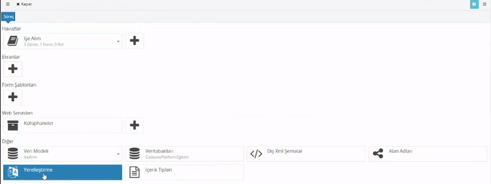
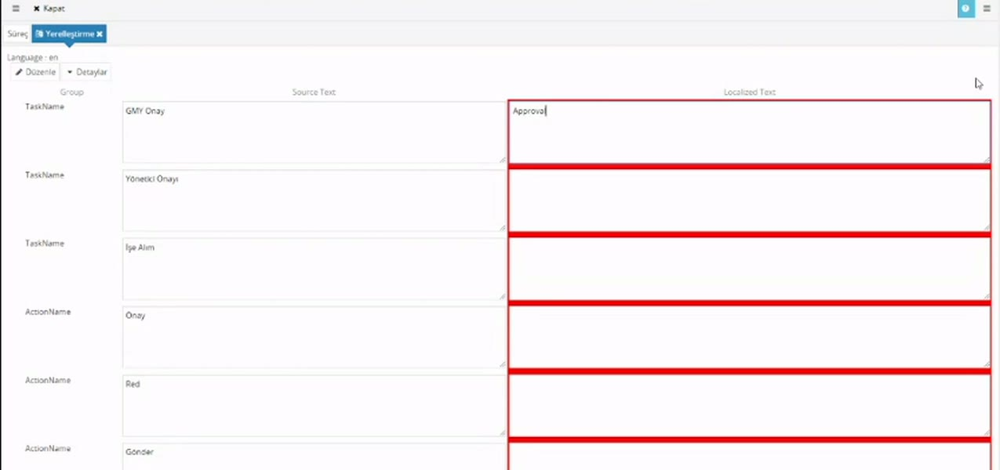

# Yerelleştirme

> **Taslak.** Biçim ve içerik onayı bekliyor.

Süreci tek dilde tasarlarsınız; başka dilde çalışan kullanıcılar için metinlerin çevirisini **Yerelleştirme** ekranında girersiniz. Bu sayfa dil eklemeyi, çevirileri yazmayı ve çalışırken hangi dilin gösterildiğini anlatır.

## Dil ekleme

1. Süreç ekranında **Diğer** başlığının altındaki **Yerelleştirme**'ye tıklayın.
2. **Yeni Ekle**'ye basın.
3. **Language** listesinden dili seçin ve **Tamam**'a basın.

Dil listesi İngilizce adlarla ve alfabetik sıradadır (Türkçe için **Turkish**). Eklenen dil satırda koduyla görünür: `Language : en`. Bir dili yalnızca bir kez ekleyin.

Dili kaldırmak için satırdaki **Düzenle**'ye, ardından **Sil**'e basın.

Tasarımda yazdığınız metinler sürecin özgün metinleridir; ayrıca bir "ana dil" seçilmez. Süreci Türkçe tasarladıysanız İngilizce eklersiniz, İngilizce tasarladıysanız Türkçe.

## Çevirileri yazma

Dil satırındaki **Detaylar**'a basın. Süreçteki çevrilebilir metinlerin tablosu açılır.

| Sütun | Ne gösterir |
|---|---|
| Group | Metnin türü (aşağıdaki tablo). |
| Source Text | Tasarımda yazdığınız özgün metin. Kendiliğinden gelir. |
| Localized Text | Çevirisi. Buraya siz yazarsınız. |

- Çevirisi boş olan kutular **kırmızı** görünür. Bu yalnızca eksikleri göstermek içindir; boş bırakıp kaydedebilirsiniz.
- Çevirisi boş bırakılan metin, çalışırken özgün haliyle görünür.
- Aynı metin süreçte birden çok yerde geçiyorsa tabloda tek satırdır; bir kez çevirirsiniz.
- Tablonun altındaki **İçeri Al** ve **Dışarı Aktar** ile çevirileri Excel'de hazırlayabilirsiniz.

> **Source Text kutusunu değiştirmeyin.** Buradaki değişiklik çeviriyi değil, süreçte o metnin geçtiği her yeri değiştirir.

### Hangi metinler listelenir

| Group | Metin |
|---|---|
| `TaskName` | Görev adları |
| `ActionName` | Aksiyon adları |
| `ActionConfirmation` | Aksiyonun onay sorusu |
| `Instructions` | Talimatlar |
| `RoleName` | Rol adları |
| `FormCaption` | Form başlığı |
| `Label` | Form etiketleri ve doğrulama mesajları |
| `Literal` | Tablo sütun başlıkları, altbilgiler, formdaki sabit yazılar |
| `FieldHint`, `PlaceHolder` | İpuçları ve kutu içi örnek yazılar |
| `ListItem`, `DropDownItem` | Sabit listelerin seçenekleri |
| `Template`, `TemplateSubject` | E-posta şablonlarının gövdesi ve konusu |
| `Custom` | Elle eklediğiniz satırlar |

Sürecin adı bu listede yer almaz. Veri tabanından gelen liste seçenekleri de burada çevrilmez; yalnızca tasarımda elle yazılan metinler listelenir.

## Süreç değiştiğinde

Yerelleştirme ekranı her açıldığında süreci tarar: yeni eklenen metinler için boş satır açar, artık kullanılmayan metinlerin satırını siler. Ekran açıkken aynı taramayı **Yenile** düğmesi yapar.

- Forma yeni bir alan eklediyseniz Yerelleştirme'yi açıp yeni satırın çevirisini girin. Açmazsanız yeni metin her dilde özgün haliyle görünür.
- **Bir metni değiştirirseniz çevirisi silinir.** Satırlar özgün metne göre eşleşir; etiketi "Doğum Tarihi" yerine "Doğum tarihi" yaptığınızda eski satır kalkar, yenisi boş gelir. Metin düzeltmelerinden sonra çevirileri denetleyin; büyük değişikliklerden önce **Dışarı Aktar** ile yedek alın.

## Çalışırken hangi dil gösterilir

Akışın dili, **akış başlatıldığı anda başlatan kişinin dili** olarak belirlenir ve akış boyunca değişmez.

| Ne | Hangi dilde |
|---|---|
| Görev formu, görev ve aksiyon adları | Akışın dilinde; görevi açan kişinin dili farklı olsa da. |
| Bildirim e-postaları | Akışın dilinde; alıcının dilinde değil. |
| Dizindeki başlangıç kutucukları, süreç şeması | Bakan kullanıcının kendi dilinde. |

Örnek: İngilizce kullanan biri masraf talebi başlatırsa, Türkçe kullanan yöneticisi onay formunu ve e-postasını İngilizce görür.

Akışın dili için dil eklenmemişse ya da metnin çevirisi boşsa özgün metin gösterilir.

Gerekirse akışın dili scriptle değiştirilebilir: `$Instance.Culture = 'tr';`

## İlgili sayfalar

- [Görev ayarları](/gorev-ayarlari)
- [Açılır liste](/acilir-liste)

---

**Kaynak:** CodEase Eğitim 2 – Fatih, 17:07–20:00. Videoda eksik ya da belirsiz kalan noktalar ürün davranışına göre tamamlandı.
