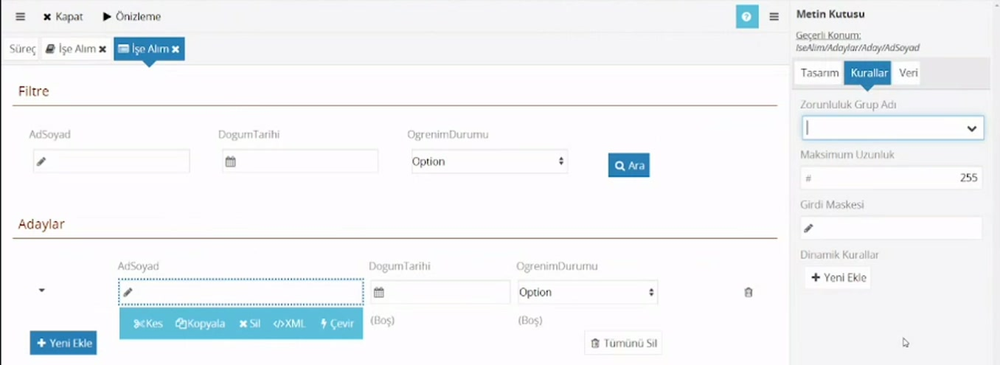
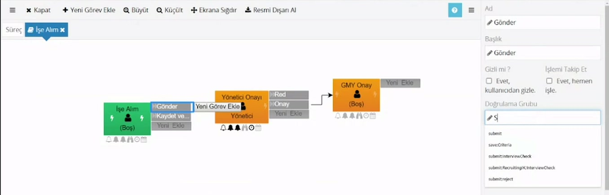
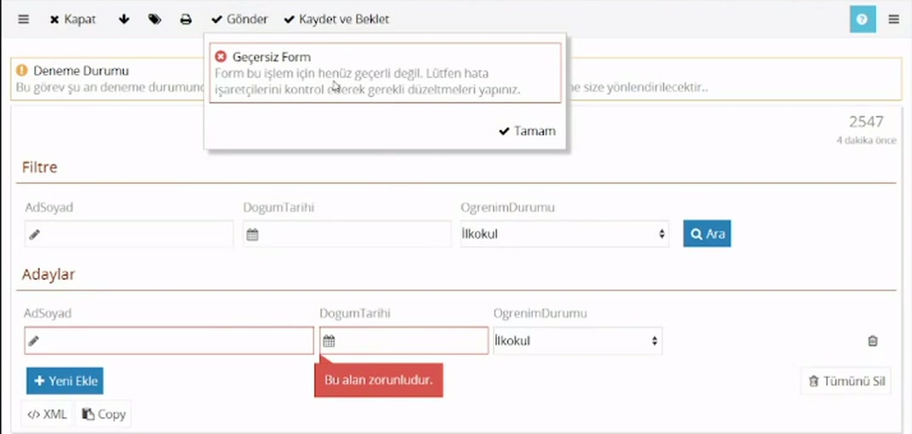

# Zorunlu alanlar

> **Taslak.** Biçim ve içerik onayı bekliyor.

Bir alan doldurulmadan kullanıcının ilerleyememesini istiyorsanız alanı zorunlu yaparsınız. CodEase'de zorunluluk alana tek başına verilmez; **alan ile aksiyon bir grup adı üzerinden eşleştirilir.** Böylece aynı alan **Gönder**'de zorunlu, **Kaydet ve Beklet**'te serbest olabilir.

İki adım vardır ve ikisi de gereklidir.

## 1. Alana grup adı verin

1. Form tasarımcısında alana tıklayın.
2. Sağ panelde **Kurallar** sekmesine geçin.
3. **Zorunluluk Grup Adı** alanına bir ad yazın (örnek: `submit`).

Zorunlu olacak bütün alanlara aynı adı verin. Alan, aksiyonlarda daha önce kullanılmış grup adlarını öneri olarak listeler.

## 2. Aksiyona aynı grup adını yazın

1. Akış şemasında aksiyona (örnek: **Gönder**) tıklayın.
2. Sağ paneldeki **Doğrulama Grubu** alanına aynı adı yazın.

Bundan sonra kullanıcı **Gönder**'e bastığında, grup adı `submit` olan alanlardan biri boşsa aksiyon alınmaz.

> **Yalnızca birinci adımı yaparsanız hiçbir şey olmaz.** Alana grup adı yazıp hiçbir aksiyona bağlamazsanız alan zorunlu olmaz ve formda zorunlu olduğuna dair bir işaret de görünmez.

## Kullanıcı ne görür

Boş bırakılan alanlar kırmızı çerçeveyle işaretlenir, altlarında **"Bu alan zorunludur."** yazar ve formun geçerli olmadığını söyleyen bir uyarı penceresi açılır. Kullanıcı eksikleri tamamlayıp aksiyonu yeniden alır.

Uyarı penceresinin başlığı ve metni sürüme göre farklı olabilir; güncel sürümde başlık "Eksik veya Hatalı Bilgi"dir.

## Hangi alan "boş" sayılır

- Hiçbir şey yazılmamış ya da yalnızca boşluk yazılmış alan.
- **Değeri `0` olan alan.** Sayı alanına 0 yazılmışsa ya da listede değeri `0` olan seçenek seçilmişse alan boş sayılır.
- Açılır liste ve radyo düğmede bakılan şey seçeneğin **değeridir** (`Id`), yazısı değil.
- Tabloda zorunluluk, en az bir satır bulunması demektir.

> **Açılır listelerde dikkat:** Açılır liste, seçim yapılmamışsa ilk seçeneği kendiliğinden seçer; bu yüzden zorunluluk uyarısı hiç çıkmaz. Listenin boş başlamasını sağlayın: [Açılır liste → Listenin boş başlaması](/acilir-liste#listenin-bos-baslaması).

## Birden çok grup

Farklı aksiyonlarda farklı alanları zorunlu kılmak için birden çok grup adı kullanın. Adlar noktalı virgülle ayrılır.

- Bir alan birden çok gruba girebilir: **Zorunluluk Grup Adı** → `submit;approve`
- Bir aksiyon birden çok grubu denetleyebilir: **Doğrulama Grubu** → `submit;approve`

Aksiyon tarafında noktalı virgülün çevresine **boşluk koymayın**; `submit; approve` yazarsanız ikinci grup eşleşmez.

Bir alanı bütün aksiyonlarda zorunlu yapan tek bir ayar yoktur. Bunun için bütün aksiyonlara aynı grup adını verin.

## Örnek: Gönder'de zorunlu, Kaydet ve Beklet'te serbest

Kullanıcı aday bilgilerini parça parça girecek, hepsi tamamlanınca gönderecek.

| Nerede | Ayar |
|---|---|
| `AdSoyad`, `DogumTarihi`, `OgrenimDurumu` alanları | **Zorunluluk Grup Adı**: `submit` |
| **Gönder** aksiyonu | **Doğrulama Grubu**: `submit` |
| **Kaydet ve Beklet** aksiyonu | **Doğrulama Grubu**: boş |

Kullanıcı eksik formla **Kaydet ve Beklet**'e basabilir, **Gönder**'e basamaz. **Kaydet ve Beklet** aksiyonunun kurulumu: [Akış tasarımı → Aynı göreve dönen rota](/akis-tasarimi#aynı-goreve-donen-rota-kaydet-ve-beklet).

## Kurallar sekmesindeki diğer ayarlar

**Dinamik Kurallar** → **Yeni Ekle** iki tür kural sunar:

| Kural | Ne işe yarar |
|---|---|
| Biçimlendirme Kuralı | Bir koşula göre alanı gizler, düzenlemeye kapatır ya da görünümünü (kalın, italik, metin rengi, arka plan rengi) değiştirir. |
| Doğrulama Kuralı | Bir koşul gerçekleştiğinde kendi yazdığınız hata mesajını gösterir ve aksiyonu engeller (örnek: bitiş tarihi başlangıçtan önce olamaz). |

İkisinde de koşul **Kural Şartı** alanına script olarak yazılır: [Dinamik kurallar](/dinamik-kurallar). Metin kutularında ayrıca **Maksimum Uzunluk** ve **Girdi Maskesi** bulunur.

---

**Kaynak:** CodEase Eğitim 4 – Fatih, 33:30–40:00. Videoda eksik ya da belirsiz kalan noktalar ürün davranışına göre tamamlandı.
